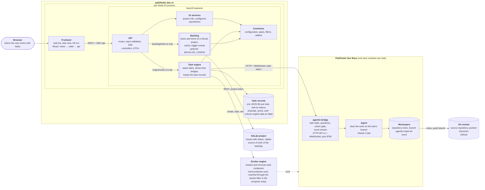
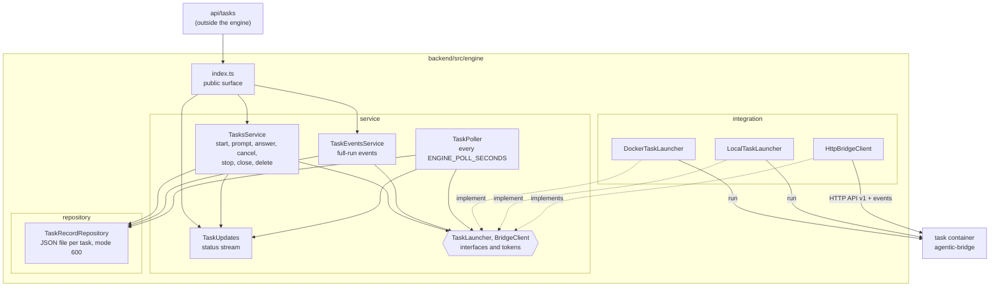

# pathfinder-dev-ui

A web UI for [agentic-dev-base](https://github.com/popescualextraian/agentic-dev-base) tasks. You pick a
repository, write a prompt, and the app starts a container with the repository's agentic image, runs the
agent in it and shows you the run: its state, its questions, its last answer and the full event stream.
You can reply, answer questions, cancel a turn, close the task when it is done, or open the branch it
pushed.

One Node process (NestJS, Node 22+) serves the React frontend and the REST/SSE API under `/api`. Behind
the API sits the **task engine** (`backend/src/engine`): the part that starts task containers, talks to
their bridges and keeps the task records. It is its own package with no dependency on the rest of the
backend except `commons`, so it can later move to a project of its own.

```sh
npm install && npm run build
cp .env.example .env   # set ENGINE_IMAGE and your tokens, see Configuration
npm start              # http://localhost:3000
```

No Docker at hand? `npm run start:local` runs tasks as local processes (see Local launcher).

Setting up a machine for the team (WSL, Docker, your project, the UI in Docker): [docs/team-setup.md](docs/team-setup.md),
or run `claude` in this checkout and type `/pathfinder-setup`.

## Architecture



The `ui` box is the compose service `ui` (or `npm start` on the host); a task container runs the
image `ENGINE_IMAGE`, built by `agentic build`. The task records belong to the engine, not to the
task containers: in the compose setup they are
in the `engine-data` volume of the `ui` container, with `npm start` in the host folder
`ENGINE_DATA_DIR` names. Each task container has its own volume (`agentic-ui-task-<id>` at `/task`),
removed when the task is closed. With the `local` launcher a task is a process on the host instead
of a container, and Docker is not used.

- **Frontend** (`frontend/src`): task list, task view, full run, and the backlog board at `#/backlog`. Only `api/` calls the backend.
- **api** (`backend/src/api`): HTTP only: routes, DTO validation, SSE, error mapping. Tasks routes call
  the engine through `backend/src/engine/index.ts`.
- **service / repository** (`backend/src/service`, `backend/src/repository`): what only the UI needs,
  the system info footer and the configured repositories.
- **engine** (`backend/src/engine`): everything about tasks, below.
- **backlog** (`backend/src/backlog`, optional): the lanes board of one GitLab project, see Backlog. Same
  boundary as the engine: imports only `commons/`, used only through `backlog/index.ts`
  (`backend/test/unit/backlog/backlog-boundary.spec.ts`).
- **commons** (`backend/src/commons`): engine configuration from `ENGINE_*` variables, global pipes,
  interceptor and filters, small utilities. The only code the engine may import from outside itself
  (checked by `backend/test/unit/engine/engine-boundary.spec.ts`).

## Task engine



A task is one container (or, with the `local` launcher, one process) running the project's agentic
image with `agentic-bridge` as its command:

1. `TasksService.start` writes the record (prompt, two random tokens) and asks the launcher
   (`ENGINE_LAUNCHER`) to create the container, with the prompt in its environment; it gets back the
   bridge's base URL.
2. The container clones the repository, starts the bridge on branch `agentic/<task-id>` in a worktree,
   and the agent takes the first prompt.
3. `TaskPoller` reads each active task's status view and stores state, questions and the last message in
   the record. Every change goes out on `TaskUpdates` (`GET /api/tasks/stream`).
4. `TaskEventsService` relays one task's full event stream (`GET /api/tasks/:id/events`).
5. Prompt and answer wake a container that is not running (not one stopped with `/stop`, that is
   final); `close` removes container and volume and keeps the record.

Inside the engine the same layering applies: the service owns the `TaskLauncher` and `BridgeClient`
interfaces and never imports an integration class; `TasksServiceModule` wires the implementations.
Details follow.

## Task cost

The cost plugin in the task container appends `cost-record/v1` snapshots to `ledger.jsonl` in the directory
named by `AGENTIC_COST_LEDGER_DIR` (both launchers set it to the task directory, `/task` in a container). The engine reads
that file through the launcher (also from a stopped container) when a turn ends and for the next two poll rounds, and on stop and close, keeps the
latest snapshot per session, and stores the sum as `cost` in the task record and API view. Lines that are not valid
records of this task are skipped; a closed task keeps its last cost. The UI shows it in the facts panel.

## Engine overview

The engine starts and drives agentic-dev-base tasks. A task is one container running the project's
agentic image with `agentic-bridge` as its command.

- `POST /api/tasks` creates a container (and volume) per task through a `TaskLauncher` (Docker, or the `local` process launcher for development),
  with the task's prompt, two random per-task tokens (task token, agent token), and your secrets
  (`CLAUDE_CODE_OAUTH_TOKEN`, `GH_TOKEN`) in its environment.
- The container clones the repository itself when it starts (start step `05-workspace`, git
  credentials from `GH_TOKEN`, never written to a file) and works on its own branch
  `agentic/<task-id>` in a git worktree (`AGENTIC_WORKTREE=1`). The task gets the `push` and `open-pr`
  grants (`AGENTIC_ALLOWED_ACTIONS=push,open-pr`, both launchers; `deploy` needs a named target, merges
  and protected words stay blocked by the bridge's gate); the branch stays on GitHub after the task is removed.
- The engine talks to each task's bridge (HTTP API v1, `Authorization: Bearer <task token>`) at
  `http://<container-name>:8765`. The UI and the task containers share one Docker network
  (`ENGINE_DOCKER_NETWORK`); the engine sets `AGENTIC_BRIDGE_HOSTS=<container-name>` so the bridge
  accepts that Host header. Live bridge events (WebSocket) are passed on as Server-Sent Events.
- Task records are one JSON file per task (mode 600) under `ENGINE_DATA_DIR`. They hold the tokens,
  which never leave the backend: no API response or container label contains one.
- At most `ENGINE_MAX_RUNNING` task containers run at once; a start (or waking a suspended task)
  beyond that is refused with 409. Prompting or answering a task whose container is not running
  (suspended, or stopped outside the engine with `docker stop`) starts it first and waits for its
  bridge. A task stopped with `POST /stop` (or whose bridge reports `stopped`) is final: prompt and
  answer are refused with 409 ("task is stopped") at once, without starting its container.
- **Task poller.** Every `ENGINE_POLL_SECONDS` the engine reads `GET /events?since=<last seq>&view=status`
  (the bridge's status view: `state`, `question`, `answer`, `error` and final `message` events, with the full
  stream's `seq` numbers) of every task that is `starting` or `running`, and once of a task it has just acted on
  (a new task, a prompt, an answer, a wake-up). It keeps in the record the state, the open questions, the
  whole last agent message (`lastMessage`, not cut to 300 characters like the bridge's `summary`) and the
  cursor, so nothing is lost between polls or across an app restart. Idle, suspended, stopped and closed
  tasks change only through the engine's own actions and are not polled. A failed poll (container gone,
  bridge not answering) is logged and retried in the next round; it does not change the state. Up to four
  tasks are polled at once. Every change a poll or an action makes to a task is also sent on the status
  stream (`GET /api/tasks/stream`).
- **Closing.** `POST /api/tasks/:id/close` stops the task if it runs, removes its container and volume and
  keeps the record (prompt, last response, branch, times) with `closed: true`; the task then belongs to
  the `done` section. A closed task takes no prompt, answer or cancel (409). `DELETE` removes the record of a
  closed (or stopped) task for good.
- Task container: image `ENGINE_IMAGE`, name and volume `agentic-ui-task-<id>` (volume mounted at
  `/task`), labels `agentic-ui.task=<id>` and `agentic-ui.kind=task`, all capabilities dropped,
  `no-new-privileges`. Removing a task deletes container, volume and record.

The task needs its repository cloned **before the bridge starts**: with `AGENTIC_WORKTREE=1` the
bridge creates the worktree at boot and exits ("could not create the worktree") if `/work` is not a
git checkout with at least one commit. In the Docker launcher the `05-workspace` start step does the
clone from `AGENTIC_REPO_URL`.

The engine has no authentication of its own: whoever can reach port 3000 can start tasks that use
your tokens. With the backlog on, anyone who can reach the unauthenticated API can also write GitLab
issues through `/api/backlog`. Do not expose it beyond a trusted network.

## Configuration

The engine reads environment variables (`backend/src/commons/engine-config.ts`); copy
`.env.example` to `.env` (git-ignored) and fill it in. The app refuses to start when a required value
is missing or invalid, naming the variable, never printing a value.

| Variable | Required | Meaning |
|---|---|---|
| `ENGINE_LAUNCHER` | no, default `docker` | Which launcher runs tasks: `docker` or `local` (see Local launcher). An unknown value is refused when the launcher is created. |
| `ENGINE_LOCAL_AGENT` | no, default `fake`; `local` only | `fake` (scripted fake agent) or `claude` (the bridge's default agent, Claude Code). Anything else is refused at start-up. |
| `ENGINE_IMAGE` | `docker` only | Task image that runs `agentic-bridge`: the project's agentic image built with `agentic build`, for example `agentic-pathfinder-dev-ui:local`. Not the image of `Dockerfile`. |
| `ENGINE_DOCKER_NETWORK` | `docker` only | Docker network shared by the UI and the task containers (`agentic-ui` in `compose.yaml`, or `TASK_NETWORK`). |
| `ENGINE_DATA_DIR` | yes | Absolute directory for task records (`/data` in `compose.yaml`). |
| `ENGINE_REPO_URL` | yes | Repository tasks clone when the request gives no `repoUrl`. Must not contain credentials. |
| `ENGINE_REPOS` | no | JSON array of `{"name", "url"}`: more repositories a task can be started in by name (`repository` in `POST /api/tasks`, listed by `GET /api/repositories`). Names are unique (letters, digits, `.`, `_`, `-`); URLs are https without credentials; with `ENGINE_LAUNCHER=local` an entry may also be an absolute local path (no host is added; the docker launcher refuses a path). A bad value is refused at start-up naming only the variable. `ENGINE_REPO_URL` stays the default, named after the last part of its URL. The host of every listed URL is an allowed repository host. Example: `[{"name":"docs","url":"https://github.com/acme/docs.git"}]` |
| `ENGINE_POLL_SECONDS` | no, default `15` | Seconds between two rounds of the task poller (positive integer). |
| `ENGINE_ALLOWED_REPO_HOSTS` | no | Comma-separated hosts a request's `repoUrl` may use, in addition to the host of `ENGINE_REPO_URL` (which is always allowed). The host of a repository gets `GH_TOKEN` for the clone, so other hosts are refused with 400. |
| `ENGINE_PROJECT` | yes | Project name passed to tasks (`AGENTIC_PROJECT`). |
| `ENGINE_GIT_NAME` | `docker`; `local` only when `GH_TOKEN` is set | Commit author and committer name of task containers (`GIT_AUTHOR_NAME`, `GIT_COMMITTER_NAME`). |
| `ENGINE_GIT_EMAIL` | `docker`; `local` only when `GH_TOKEN` is set | Commit author and committer email (`GIT_AUTHOR_EMAIL`, `GIT_COMMITTER_EMAIL`). |
| `ENGINE_MAX_RUNNING` | no, default `2` | Maximum running task containers (positive integer). |
| `CLAUDE_CODE_OAUTH_TOKEN` | `docker`; `local` only with `ENGINE_LOCAL_AGENT=claude`; secret | Passed into task containers. |
| `GH_TOKEN` | `docker`; optional for `local` (needed only to push); secret | Passed into task containers; used for the clone and for push. |
| `ENGINE_TASK_EXTRA_ENV` | no, test hook | JSON object of strings added to each task container's environment (keys must be valid variable names; keys the engine sets itself, such as the tokens, `GH_TOKEN`, `AGENTIC_TASK_ID`, `AGENTIC_BRANCH`, `AGENTIC_BRIDGE_HOSTS`, the four `GIT_AUTHOR_*`/`GIT_COMMITTER_*` identity variables, `GIT_CONFIG_COUNT` and `GIT_CONFIG_KEY_<n>`/`GIT_CONFIG_VALUE_<n>`, are refused at start-up). |
| `ENGINE_TASK_EXTRA_BINDS` | no, test hook | JSON array of `host:container[:mode]` binds added to each task container. Does not work through the Docker socket filter of the compose setup: every launch is refused with 403 (the filter allows only the task volume as bind). |
| `ARCHITECTURE_ENABLED` | no | `1` turns the Architect page on (routes `/api/architecture`, menu entry **Architect**); `0` or unset leaves it off, anything else is refused at start-up. See Architect. |
| `ARCHITECTURE_DATA_DIR` | no | Absolute directory of the bare clones the Architect page reads (mode 700). Default `architecture` next to `ENGINE_DATA_DIR`; `compose.yaml` sets `/data/architecture`. |
| `ARCHITECTURE_FETCH_SECONDS` | no, default `60` | Minimum seconds between two fetches of one repository, integer 1 to 3600. |

`ENGINE_DATA_DIR`, `ENGINE_REPO_URL` and `ENGINE_PROJECT` are required for every launcher. `PORT` (default 3000) sets the HTTP port; the app listens on all interfaces. Docker itself is reached through the usual socket or
`DOCKER_HOST` (dockerode); in the compose setup `DOCKER_HOST` points at the filtered socket (see Deployment).

## REST API

All under `/api`, JSON, times are ISO 8601 UTC strings. A task view contains the task's fields without tokens:

| Field | |
|---|---|
| `id`, `title`, `prompt` | `title` is the given one or the prompt's first line, at most 80 characters; `prompt` is the whole initial prompt |
| `repository`, `repoUrl`, `repoRef?`, `model?`, `branch` | `repository` is the name (from `/api/repositories`, or the last part of the URL for another URL) |
| `state`, `reason?`, `section` | `state` is the last known one (`starting` `running` `waiting` `idle` `suspended` `stopped` `failed` `interrupted`); `section` is computed: `closed` or `stopped` → `done`; `waiting`, `failed`, `interrupted` → `needs-you`; `starting`, `running` → `working`; `idle`, `suspended` → `in-review` |
| `questions` | open questions only: `{id, source, text, options, recommendation, asked}` |
| `lastMessage?`, `lastMessageAt?`, `summary?` | the whole last agent message (from the poller) and its time; `summary` is the bridge's, cut to 300 characters, a fallback |
| `cost?` | what the task cost: `{input, output, cacheRead, cacheWrite, usd: {estimate?, billedCredits?, unknown?}, sessions, snapshotAt, readAt}`; USD per source, never summed across sources (see Task cost) |
| `createdAt`, `updatedAt`, `closed`, `closedAt?` | `updatedAt` is the last change of the record; a record without `closed` counts as not closed |

| Route | Does | Success |
|---|---|---|
| `GET /api/repositories` | `[{name, url, default}]`, the default first (see `ENGINE_REPOS`) | 200 |
| `POST /api/tasks` `{prompt, title?, repository?, repoUrl?, repoRef?, model?}` | Starts a task and waits for its bridge. `repository` is a name from `/api/repositories`; with `repoUrl` too it is 400, as is an unknown name. `repoUrl` must be https without credentials, on an allowed host (see `ENGINE_ALLOWED_REPO_HOSTS`). With neither, the default repository (`ENGINE_REPO_URL`). | 201 task |
| `GET /api/tasks` | All tasks, newest `createdAt` first, closed ones included, as last recorded (no bridge call) | 200 |
| `GET /api/tasks/:id` | Task with live bridge status (state, reason, open questions, summary, branch); a closed task is read from its record | 200 |
| `POST /api/tasks/:id/prompt` `{text, session?}` | Sends a prompt (to `session`, default `main`); wakes a container that is not running first; 409 for a closed or stopped task | 202 task |
| `POST /api/tasks/:id/answer` `{text, question?}` | Answers a question; default is the oldest open one; wakes like prompt; 409 for a closed or stopped task, or without an open question | 202 task |
| `POST /api/tasks/:id/cancel` `{session?}` | Cancels the running turn (of `session`, default `main`); 409 for a closed task | 202 task |
| `POST /api/tasks/:id/close` | Stops the task if it runs, removes container and volume, keeps the record with `closed: true`. Closing a closed task is 202 as well | 202 task |
| `POST /api/tasks/:id/stop` | Bridge `/stop`, then stops the container | 202 task |
| `DELETE /api/tasks/:id` | Removes the record (and container and volume, if still there); 409 unless the task is closed or stopped | 204 |
| `GET /api/tasks/:id/sessions` | The task's sessions (see Sessions) | 200 |
| `POST /api/tasks/:id/sessions` `{name, model?, forkFrom?, prompt?}` | Adds a session; wakes the task like prompt does (see Sessions) | 201 task |
| `GET /api/tasks/:id/events?since=N&session=NAME` | Events after sequence number N as a JSON array; 409 when the container is not running (always for a closed task) | 200 |
| `GET /api/tasks/:id/events/stream?since=N&session=NAME` | The full run: the same events, then live ones, as SSE (`id` is the event `seq`; `Last-Event-ID`, which EventSource sends on reconnect, takes precedence over `since` when present) | 200 |
| `GET /api/tasks/stream` | The status stream, SSE: `event: task` with the task view when a task is created or changed (state, questions, last message, title, closed), `event: removed` with `{"id"}` when one is deleted, and a `: ping` comment every 25 seconds. Nothing is replayed on connect: load `GET /api/tasks` first (and again after a reconnect), then apply the events. | 200 |
| `GET /api/schedules` and the other `/api/schedules` routes | Scheduled runs (see Schedules) | |
| `GET /api/architecture/status` and the other `/api/architecture` routes | The Architect page's data, only with `ARCHITECTURE_ENABLED=1` (see Architect) | |
| `GET /api/health` | `{"ok":true}`; no Docker or other call, used by the compose health check | 200 |
| `GET /api/system/info` | `{ name, version, uptimeSeconds }` | 200 |

Errors: bridge 400, 404, 409 and 503 pass through with the bridge's message; any other bridge answer
(including 401/403) and an unreachable bridge give 502 with a fixed message. An unknown task is 404;
starting beyond `ENGINE_MAX_RUNNING` is 409. Limits: `prompt`/`text` at most 20000 characters and not
blank, `title` at most 200 (shortened to 80). Errors have the body `{statusCode, message, path}` (a validation error is 400 with `message` as a list of strings). Errors inside an SSE stream that already started arrive as an SSE `error` event.

## Sessions

A task can hold several agent sessions (conversations) that run, ask and get answered independently. Every
task has `main`; without a `session` parameter every route works on `main` as before. The task view lists
them as `sessions: [{name, model?, state, reason?, forkOf?, createdAt, lastMessage?, lastMessageAt?, questions}]`
in creation order; each open question carries its `session`. The task-level `state`, `section` and
`lastMessage` stay: a question in any session puts the task under Needs you, and `lastMessage` is the most
recent final message of any session. A record from before sessions shows one `main` session.

- `POST /api/tasks/:id/sessions` `{name, model?, forkFrom?, prompt?}`: `name` matches `[a-z0-9][a-z0-9_-]{0,31}`;
  `forkFrom` copies the conversation of an existing, idle session; `prompt` is the first turn. 400 for a bad
  name or model, 404 for an unknown `forkFrom`, 409 for a name already taken, the session limit, a busy source
  or a stopped task.
- `session` on `prompt` and `cancel`; an answer goes to the session its question belongs to, and without a
  question id the oldest open question (of `session`, when given) is answered.
- `GET .../events` and `.../events/stream` with `session=NAME` return that session's events only (the engine
  filters by the event's `name`). Events without a `name` (task-level ones such as container or state events)
  appear in every session's view. Without `session` all events are returned.

In the UI, a tab row above the run shows one tab per session (name, state, a mark for an open question) and a
`+ Session` button (name, optional model, optional "copy conversation from" an idle session, optional first
prompt). The selected tab shows that session's last response, questions, reply box, cancel and full run;
title, facts, stop and close stay task-level. The task cards show `N sessions` when there are several and
which session asks. The route is `#/tasks/<id>?session=<name>` (or `#/repo/<name>/task/<id>?session=<name>`);
`main` is the default and an unknown name falls back to it.

## Apps

A task's container can run apps (a web app, a dev server) that you start from the task view. They are
configured in the project, not here: the `apps:` section of `.agentic/agentic.yaml` (see the
agentic-dev-base documentation) is built into the task image as the label `agentic.apps`, and the
bridge in the container runs them. The UI only relays.

| Route | Does | Success |
|---|---|---|
| `GET /api/tasks/:id/apps` | The apps: `{name, state, ports, url, since, exit_code?, link}`; `state` is `running`, `preparing`, `stopped`, `exited` or `failed`, `since` unix seconds or `null`; `link` is the host URL, `null` without a published port | 200 |
| `POST /api/tasks/:id/apps/:name/start` | Starts the app (wakes a suspended task first) | 202 app |
| `POST /api/tasks/:id/apps/:name/stop` | Stops the app | 202 app |
| `POST /api/tasks/:id/apps/:name/restart` | Restarts the app (wakes a suspended task first) | 202 app |
| `GET /api/tasks/:id/apps/:name/logs?lines=N` | The last lines of the app's log: `{lines: []}` | 200 |

- Docker launcher only: with `ENGINE_LAUNCHER=local` the routes answer 409. A stopped or closed task is 409 too.
- On these routes a failed `agentic-app` run (bridge 502 `app_failed`, e.g. a failed prepare) and its timeout
  (504 `app_timeout`) keep their status and the bridge's message (the last output lines, tokens masked).
- A suspended task's apps cannot be listed (409); the task view then shows the app names of the task record
  (`appNames` in the task view) with Start, which wakes the task.
- Links point at `http://localhost:<port>` (published on 127.0.0.1 only). The host ports are random and
  are read again on every start of the task container, so a link from before a restart of the task is stale.
- In the compose setup the task containers are siblings of `ui`, created by the Docker engine: their ports are
  published on the Docker host's 127.0.0.1, so the links work in a browser on the Docker host (elsewhere,
  forward the port, for example with `ssh -L`). The socket filter allows exactly these bindings, at most 20
  distinct ports per task; an image whose label names more starts its tasks without apps (see Deployment).
- Start and restart can take minutes when the app prepares first (for example `npm ci`): the bridge
  allows 11 minutes for start and 14 for restart, stop 3, and the UI waits slightly longer than each.

## Backlog

An optional board of the issues of one GitLab project, in lanes (todo, plan, in progress, ...). It is off
unless `BACKLOG_CONFIG` is set; while it is unset there are no `/api/backlog` routes and no board. GitLab stays the
source of truth; the app keeps a cache and polls it.

| Variable | Meaning |
|---|---|
| `BACKLOG_CONFIG` | Path of the lanes YAML (copy `backlog.example.yaml`). Unset or empty: the backlog is off. |
| `BACKLOG_DATA_DIR` | Directory of the cache (relative paths resolve against the working directory), one file `backlog.json`. Required when `BACKLOG_CONFIG` is set. |
| the token variable | Named by `gitlab.tokenEnv` in the YAML (`GITLAB_TOKEN` in the example); a GitLab token with the `api` scope. The YAML never holds the value, and the value is never logged or returned. |

The YAML is read at start-up (a restart applies changes); a bad key is refused naming the key, never a value:

```yaml
connector: gitlab
gitlab:
  baseUrl: https://gitlab.zt.msg.team
  project: moldovaa/vans-factory-rotation
  tokenEnv: GITLAB_TOKEN
pollSeconds: 60        # optional, default 60
doneDays: 14           # optional, default 14: closed issues updated within this many days are listed
lanes:                 # in board order; ids unique; exactly one lane has default: true
  - { id: todo, title: Todo, default: true, gitlab: { label: "status::todo" } }
  - { id: plan, title: Plan, trigger: plan.enter, gitlab: { label: "status::plan" } }
  - { id: done, title: Done, gitlab: { state: closed } }
```

Lane keys: `id`, `title` (required), `default` (items that match no lane land here), `trigger` (an opaque
name emitted when an item is moved into the lane), `gitlab` (the only part the GitLab connector reads:
`label`, or `state: closed`). An issue's lane is the lane whose label it carries, else the `state: closed`
lane when it is closed, else the default lane. A move replaces the issue's lane label (other labels stay)
and closes or reopens the issue for a `state: closed` lane. Missing lane labels are created at the first sync.

| Route | Does | Success |
|---|---|---|
| `GET /api/backlog/lanes` | `{me, lanes: [{id, title}]}` in board order | 200 |
| `GET /api/backlog/items` | All items from the cache: `{id, title, description, lane, assignees, url, fileLinks, updatedAt}` | 200 |
| `GET /api/backlog/items/:id` | One item | 200 |
| `POST /api/backlog/items` `{title, description?, lane?}` | Creates an issue (title 1-255 characters, description up to 100000). Without `lane` it goes to the default lane; a lane that GitLab closes (state `closed`) or an unknown lane is 400 | 201 item |
| `PATCH /api/backlog/items/:id` `{title?, description?, assignees?}` | Changes the given fields (at least one, else 400). `assignees` are usernames (at most 20); an unknown user is 400, `[]` unassigns everyone. The lane never changes here, only moves change it. Unknown item is 404 | 200 item |
| `POST /api/backlog/items/:id/move` `{from, to}` | Moves the item to lane `to`. `from` is the lane the client believes it is in: if the source has it elsewhere the move is refused with 409 and nothing is written (the board reloads the item). Unknown item is 404, unknown lane is 400 | 200 item |
| `PUT /api/backlog/items/:id/file-links` `{links: [{repo, path, ref?, note?}]}` | Replaces the item's file links (at most 100) | 200 links |
| `POST /api/backlog/refresh` | Reads GitLab now; 503 when it is unreachable (the cache stays) | 200 items |
| `GET /api/backlog/stream` | SSE: `event: item` with the item when one is added or changed, `event: removed` with `{"id"}`, `event: error` with `{"message"}` when GitLab could not be read, and a `: ping` comment every 25 seconds. Nothing is replayed: load `items` first | 200 |

Errors have the usual `{statusCode, message, path}` body: invalid request 400 (also what GitLab answers with 400 or 422), not found 404, changed in the source 409, GitLab
unreachable 503 (also any other unexpected GitLab answer), with fixed messages (no tokens, URLs or upstream bodies).

File links are stored in GitLab as one comment per issue, written by the token's user: an HTML comment marker
`<!-- pathfinder:file-links v1`, the links as JSON, then a readable list. The app rewrites that comment (it
never adds a second one); edits made to it by hand are overwritten, and only comments by the token's own user count.

Trigger events `{itemId, from, to, trigger, at}` are emitted in-process (`BacklogTriggers`, exported by
`backlog/index.ts`) only for moves made through `BacklogService.move` into a lane with a `trigger`: board moves through this
API and the card moves of workflows. Changes found by polling never emit one. Nothing listens yet.

## Workflows

A workflow carries one backlog card through steps. From a card the user starts a workflow: it creates one task
named `#<item id> <item title>` (default repository) and runs the steps one after another. A step is one prompt in one
conversation (session) of that task; when it starts, the card moves into the step's lane. Steps hand work over through files in the
task's worktree. Workflows are on only when `BACKLOG_CONFIG` **and** `WORKFLOWS_DIR` are set (`WORKFLOWS_DIR` alone is
ignored: no routes, no buttons); then `WORKFLOWS_DATA_DIR` is required.

| Variable | Meaning |
|---|---|
| `WORKFLOWS_DIR` | Absolute directory of the definitions, one YAML per workflow (copy from `workflows.example/`). Re-read on every list, no restart needed. |
| `WORKFLOWS_DATA_DIR` | Absolute directory of the runs, one mode-600 JSON file per run. Required when workflows are on. |

A definition (file name without extension = workflow id; `.yaml` or `.yml`):

```yaml
title: Plan, implement, review
steps:
  - id: plan
    title: Plan
    stage: plan                  # optional: a lane id of the backlog; the card moves there when the step starts
    prompt: |                    # the first step runs in the task's main session
      You plan backlog item #{{item.id}}: {{item.title}}
      {{item.description}}
    gate: human                  # human: wait for "Continue"; auto: go on when the step is done
    exitPrompt: Make sure the plan is complete in plans/{{item.id}}.md and committed.
  - id: implement
    title: Implement
    stage: in-progress
    requires:                    # block list or quoted items: [plans/{{item.id}}.md] is not valid YAML
      - "plans/{{item.id}}.md"
    prompt: Implement plans/{{item.id}}.md.     # a new conversation (a session named after the step id)
    gate: auto
  - id: fix
    title: Fix
    continue: implement          # optional: send this prompt into that earlier step's conversation
    prompt: Fix what the tests show.
    gate: auto
  - id: review
    title: Review
    stage: review
    fork: implement              # optional: start as a copy of that earlier step's conversation
    model: sonnet                # optional (not with continue)
    prompt: Review the branch against plans/{{item.id}}.md.
    gate: human
doneStage: done                  # optional: the card goes there when the workflow ends
```

- `title` and a non-empty `steps` are required. A step needs a unique `id` (`[a-z0-9][a-z0-9_-]{0,31}`; `main` only on the first
  step), `title`, `prompt` and `gate` (`human` or `auto`); `stage`, `requires`, `exitPrompt`, `model`, `continue` and `fork` are optional.
  The editor generates ids from the titles, so nobody has to type one.
- Conversations: a step runs in the task's `main` session if it is the first, in the session of the step it `continue`s (chains
  are followed; the prompt is sent into that conversation once the earlier step's turn is done), or in a new session named after its step id; with `fork` that new session
  starts as a copy of the named step's conversation. `continue` and `fork` name an earlier step (never the step itself) and not both; the first step has neither.
  `model` applies to a new conversation and is refused with `continue`. The exit prompt goes to the step's own session.
- Old format: a file whose steps have `sessions:` is refused with "the file uses the old format (sessions:); since task 015 a step has one
  prompt: see README". Convert a folder with `node tools/convert-workflows.mjs <dir>` (run `npx nest build` first: it uses `dist/`). It rewrites
  each old file in place (comments are lost, so keep them in a copy) and leaves new files alone; a step with more than one session is
  refused with a message and its file stays unchanged (split the step by hand; exit code 1). Runs saved in the old format are converted
  when loaded (the session names of their steps are kept), so runs in flight continue.
- Placeholders in prompts, `exitPrompt` and `requires`: `{{item.id}}`, `{{item.title}}`, `{{item.description}}`, `{{item.url}}`,
  `{{task.id}}`, `{{task.branch}}`, `{{step.id}}`. An unknown placeholder is a load error. `{{task.id}}` and `{{task.branch}}` are
  refused in the prompt of the first step: that prompt starts the task, so they are not known yet (use them in its
  `exitPrompt` or later steps).
- A file with invalid YAML, a broken rule, a `stage` that is not a lane id, a `continue`/`fork` of a step that is not earlier, or the same id as an
  earlier file (`one.yaml` and `one.yml`: the second is refused) is refused with an error naming the file; the other files still load. `GET /api/workflows` lists the refused files with their errors.
- Gates: after a step is done, `auto` goes on at once, `human` waits (`awaiting-approval`) for **Continue**.
  Continuing sends the step's `exitPrompt` (if any) to its session and waits for it, then checks the next step's `requires`, moves
  the card and starts the next step. After the last step the run is `done` and the card goes to `doneStage` if set.
- `requires`: paths relative to the task's worktree (`/work/.worktrees/<task id>` in Docker, the agent's working directory). An absolute
  path or a `..` segment is a load error; a path that becomes one once filled in (e.g. from the item's title) fails the run.
  They are checked with the next step's placeholders filled in, before the card moves. A missing file puts the run in `blocked` with a
  warning naming the files; **Start anyway** (`force`) goes on regardless. It checks that the files exist, not their content.
- Run states: `running`, `needs-you` (a session of the run has an open question), `awaiting-approval`, `blocked`, `done`, `stopped`
  (the task is left as it is), `failed` (the task failed, vanished or was stopped; the run gives the reason). A card has at most one active run.
- When an action of the run fails (moving the card, starting a session, sending the exit prompt, checking files), the run keeps its state,
  shows the error as `warning` and retries on the next change of the task and on a timer (5 s, doubling up to 60 s). From **Continue**
  the error is returned instead and the run stays as it was. A crash between sending a continued step's prompt and saving the run can send that prompt twice on restart (the same limit as the exit prompt).

| Route | Does | Success |
|---|---|---|
| `GET /api/workflows` | `{definitions: [{id, title, doneStage?, version?, steps: [{id, title, stage?, gate}]}], refused: [{file, error, version?}], writable}` | 200; `version` is absent when the file could not be read |
| `GET /api/workflows/:id` | `{definition (with prompts), version}`; `version` is a hash of the file | 200, 404 |
| `POST /api/workflows/validate` `{definition}` | `{errors: []}` or the first error `{message, stepId?, stepIndex?, field?}`; writes nothing | 200 |
| `POST /api/workflows` `{id, definition}` | Creates `<id>.yaml` (id `[a-z0-9][a-z0-9-]{0,63}`); id exists 409; broken rule 400 with `location` | 201 `{definition, version}` |
| `PUT /api/workflows/:id` `{definition, version}` | Replaces the file (a `<id>.yml` is replaced by `<id>.yaml`); changed since `version` 409 | 200 |
| `DELETE /api/workflows/:id?version=` | Deletes the file (active runs keep their snapshot); changed 409 | 204 |
| `DELETE /api/workflows/refused/:file?version=` | Deletes a refused file by name (must be in the folder listing) | 204 |
| `GET /api/workflow-runs[?itemId=]` | Active runs and the 50 most recently finished ones (of the item, if given), oldest first | 200 |
| `GET /api/workflow-runs/:id` | One run | 200 |
| `POST /api/workflow-runs` `{itemId, workflowId}` | Starts a run (creates the task, moves the card to the first stage). Unknown workflow or item 404; the item already has an active run 409; engine errors (cap 409, bridge 502) pass through | 201 run |
| `POST /api/workflow-runs/task` `{itemId, prompt, title?, model?, repository?}` | Starts a plain task on the item (a run of kind `task`, see below); `title` defaults to `#<id> <title>`, the repository to the default one. Invalid body (blank prompt, bad title/model/repository) 400; unknown item 404; the item already has an active run (workflow or task) 409; engine errors pass through | 201 run |
| `POST /api/workflow-runs/:id/advance` `{force?}` | Continue; only while `awaiting-approval` or `blocked`, else 409 (always 409 for a run of kind `task`) | 200 run |
| `POST /api/workflow-runs/:id/stop` | Marks the run `stopped`; 409 if not active | 200 run |
| `GET /api/workflow-runs/stream` | SSE: `event: run` with the run after every change, `: ping` every 25 seconds. Nothing is replayed | 200 |

A run: `{id, kind?, workflowId, definition (snapshot taken at start), itemId, item (snapshot), taskId, stepIndex, phase, sessions: {<name>: {status: pending|running|done}},
state, warning?, failureReason?, createdAt, updatedAt, finishedAt?}`. It never contains tokens. Errors have the usual `{statusCode, message, path}` body.

**Plain-task runs** (`kind: 'task'`; absent = a workflow run): a link between a work item and one ordinary task, started with
`POST /api/workflow-runs/task`. It has no workflow to follow (`workflowId: 'task'`, a definition titled `Task` without steps): the runner never moves its card
(not at start or stop; a user may still drag it by hand), starts no session and sends no exit prompt. Its state is `needs-you` while the task has an open question or a
failed or interrupted session, else `running`; it never becomes `done` by itself. Stop marks it `stopped` and leaves the task as it is; a task
that is gone makes it `failed`. One active run per item counts both kinds: a plain task blocks a workflow start and the other way round.
In the UI a card or detail without an active run has **▶ Task** next to **▶ Workflow** (also without definitions): the New task dialog
prefilled with the title `#<id> <title>` and a kickoff prompt from the item (editable), then the task screen of the new task. The run line
shows `Task`, the state, **Open task** and **■ Stop**; the task view shows `Task · #<id> on the board`.

Write routes answer 403 when the folder is not writable (a read-only mount); they have no login, like the rest of the API.
A save through the editor rewrites the file as YAML: comments of a hand-written file are not kept.

**Editor** (`#/workflows`, `#/workflows/<id>`, `#/workflows/new`): the list (Edit, Duplicate, Delete, refused files with Delete only) and
an editor showing the workflow as a flow of steps with the gate on the arrow between them (click toggles), an inspector for the selected step
grouped as title and lane, **Start** (required files, Conversation: new, continue or copy of an earlier step, Prompt), **End** (exit prompt, then: wait for approval or go on) and Advanced (model); one row of placeholder chips inserts at the cursor of the last field, and Expand opens a prompt in a large dialog. The first error is marked on its step and field. Leaving the editor with unsaved changes asks first (sidebar, address change, closing the tab).
Read-only folders open the editor read-only. Docker: compose mounts `WORKFLOWS_DIR_HOST` writable; see Docker deployment for who must be able to write it. `start:local` copies nothing by default: its folder is written in place
(Playwright's server uses a copy under `.local/<port>/workflows`).

In the UI (board, `#/backlog`): a card without a run has a **Workflow** button (a picker when there are several definitions, then a confirmation).
A card with a run shows a line with the workflow title, the step (`Plan · 1/3`) and the state (marked for `needs-you`, `awaiting-approval`,
`blocked`, `failed`), and the buttons **Open step** (the task view on the current session), **Continue** (or **Finish** after the last step),
**Start anyway** (when blocked) and **Stop workflow** (asks first). The detail panel lists the steps. Dragging a card with an active run is refused
("This card is driven by its workflow") except onto the lane of the next step while awaiting approval, which asks to continue. The task view shows
the workflow and step under the title, with a link back to the card.

Known limits: runs follow the engine's task changes, so a task that is `starting` and never comes up keeps its run waiting (no timeout; stop
the workflow); with the local launcher a restart of the app loses the tasks, and their runs fail with that reason; a run keeps the definition it
started with, later edits of the file affect only new runs. There is no editor, no storage in the project repository and no catalog yet.

With `npm run start:local`, `WORKFLOWS_DIR` and `WORKFLOWS_DATA_DIR` (default `.local/<port>/workflow-runs`) are made absolute against the
checkout. For local testing without GitLab, `connector: memory` in the lanes YAML keeps the items in memory, seeded from `memory.items`
(`{title, description?, lane?}`); it is refused unless `BACKLOG_ALLOW_MEMORY_CONNECTOR=1`, which only `start:local` sets. Try it with the Playwright fixtures:
`BACKLOG_CONFIG=e2e/fixtures/backlog.yaml WORKFLOWS_DIR=e2e/fixtures/workflows PORT=3101 npm run start:local`, then open `#/backlog`.

### Generating a workflow with AI

A second way to make a workflow beside the editor: describe it in words, an agent writes the definition, you review it in the editor and save.
Nothing is saved without you. On `#/workflows` the button **Generate with AI** opens a box with the description (1 to 4000 characters) and an optional model.

Flow: the description and a skill text (`backend/src/workflow/service/generator/workflow-author.md`, filled with the format, the placeholders and the live lane ids,
the description at the end marked as input) go as the first prompt of an ordinary agent task of kind `workflow-generator` on the default project repository
(`ENGINE_REPO_URL`, branch thrown away). The agent writes `workflow-draft.yaml` at the root of the task's worktree. When a turn is done (session idle, no open
question) the UI reads that file (`TaskLauncher.readFile`), parses it and validates it with the editor's validator. Errors, or a missing file, go back to the same
session as a fix prompt, at most 2 times (`fixing 1 of 2`); then the generation is `failed` with the errors. A valid draft is `ready`: **Open in editor**
(`#/workflows/new?generation=<id>`, an unsaved new workflow with the id proposed from the title) and Save. **Request changes** on a ready draft sends your text to the
same session and the check runs again (the fix count starts from zero). The generator task is not a card on the board; the Workflows page shows a panel per open generation
(state, the agent's open question with an answer box, last message, cost so far, errors, a link to the task view).

| Route | Does | Answer |
|---|---|---|
| `POST /api/workflows/generations` `{description, model?}` | Starts the task. `description` 1 to 4000 characters, `model` free text (empty = default) | 201 generation |
| `GET /api/workflows/generations` | Open generations (not `saved`/`discarded`), oldest first, without the draft (`hasDraft`) | 200 list |
| `GET /api/workflows/generations/:id` | One, with its draft (also `saved`/`discarded` until removed) | 200 generation, 404 |
| `POST /api/workflows/generations/:id/changes` `{text}` | Request changes; only from `ready` | 200 generation, 409 |
| `POST /api/workflows/generations/:id/saved` | The draft was saved (the editor calls it after Save); from `ready` or `failed`; closes the task | 200 generation, 409 |
| `POST /api/workflows/generations/:id/discard` | Throws the draft away; from any open state; closes the task | 200 generation, 409 |

A generation: `{id (G-YYYYMMDD-xxxxxxxx), taskId, description, model?, state, attempts (fixes sent in this round, 0..2), draft?, errors? ({message, stepId?, stepIndex?, field?}),
failureReason?, warning?, question?, lastMessage?, cost?, createdAt, ...}`; `draft` is the valid definition when `ready`, the last parsed mapping when `failed` (then
**Open in editor anyway**). States: `writing` (agent working), `asking` (open question; answer it in the panel or with the task answer route), `fixing`, `ready`,
`failed` (errors after 2 fixes, the task failed, or was stopped), and the end states `saved` and `discarded`, kept 7 days and then removed. Generations are one mode-600 JSON each in
`<WORKFLOWS_DATA_DIR>/generations` and survive a restart. A failed action (a read or prompt error) is retried on the runner's backoff, shown as `warning`.
All routes answer 403 when the workflows folder is not writable (as the editor's writes), and there is no login. A generation start that the engine refuses (cap, bridge) passes that error on.

Cost and capacity: a generation runs the real agent in the configured launcher and spends real tokens; the page says so next to the button. A `ready` draft keeps
its task running until it is saved or discarded, so it counts toward `ENGINE_MAX_RUNNING` (with the default 2, two waiting drafts block every other start, workflow runs included).

Skill file: when the workflow format changes, update `workflow-author.md` too; a unit test (`backend/test/unit/workflow/service/generator/workflow-author.spec.ts`) runs
every YAML example in it through the real validator. Nest copies the file to `dist` on build (`nest-cli.json` assets).

`TaskLauncher.readFile(taskId, path, maxBytes)` returns the content of a file in the task's worktree or `null` when missing (Docker: archive read; local: the worktree folder; the path is
checked like `hasFiles`). The cap is 64 KB, larger is an error. The generator passes only the fixed name `workflow-draft.yaml`. The task record has an optional `kind`
(`workflow-generator`), set by the generator, never accepted from the public `POST /api/tasks`; the task list and view label it "Workflow generator".

Try it without tokens: `BACKLOG_CONFIG=e2e/fixtures/backlog.yaml WORKFLOWS_DIR=e2e/fixtures/workflows PORT=3101 npm run start:local`, open `#/workflows` and put a draft in the
description with the fake agent's `FAKE_WRITE:` marker: a line `FAKE_WRITE:workflow-draft.yaml` directly followed by a fenced block with the YAML (the skill passes the description on unchanged,
so the fake agent writes the block to the worktree). A draft with a bad field ends `failed` after 2 fixes; `ASK:<question>` on its own line makes the generation `asking`. The fake agent
looks for markers in a multi-line prompt line by line: the first line starting with `ASK:` or `SLEEP:` or being exactly `CRASH` acts as that marker with the rest of that line (outside
`FAKE_WRITE` blocks); a single-line prompt or one that starts with such a marker behaves as before (see the header of `tools/fake-agent/fake-agent.mjs`).
Tests: `e2e/workflow-generation.spec.ts` (Playwright) and `backend/test/bridge/workflow-generation.bridge-spec.ts` (real bridge, local launcher, fake agent).

## Schedules

A schedule starts a task by itself at a time, runs it unattended and keeps what it reports. The UI fires schedules in-process (a tick every
`SCHEDULES_TICK_SECONDS`, no timer per schedule); the menu entry is **Schedules** (`#/schedules`, `#/schedules/new`, `#/schedules/<id>`, `#/schedules/<id>/edit`).
Schedules are always on; they use the repositories of `ENGINE_REPO_URL` and `ENGINE_REPOS`.

| Variable | Meaning |
|---|---|
| `SCHEDULES_DATA_DIR` | Absolute directory of the schedules, one mode-600 JSON file per schedule with its results. Default `schedules` next to `ENGINE_DATA_DIR` (required when `ENGINE_DATA_DIR` is not set); `compose.yaml` sets `/data/schedules`. |
| `SCHEDULES_TIMEZONE` | IANA zone (for example `Europe/Berlin`) of cron lines and one-off times; one per deployment. Default: the zone of the process (UTC in the container). The UI shows it next to times. |
| `SCHEDULES_TICK_SECONDS` | Seconds between two looks for due schedules, integer 1 to 3600, default `30`. |

A schedule: `{id, title, prompt, repository, ref?, model?, when, timeoutMinutes, enabled, nextRunAt, createdAt, updatedAt}`. The `id` is generated from the title
(`[a-z0-9-]`, at most 40, never `new`). `when` is `{cron}` (five fields, evaluated in `SCHEDULES_TIMEZONE`; the form has Daily, Weekdays and Weekly presets that write the line, and Custom)
or `{at: "YYYY-MM-DDTHH:mm"}` (local time in that zone, in the future and within a year); a cron line that never fires (for example `0 0 31 2 *`) is refused. `timeoutMinutes` is 1 to 1440, default 120.
`title`, `prompt`, `ref` and `model` follow the rules of `POST /api/tasks` (title at most 200 characters, prompt at most 20000, `ref` a branch, tag or commit of at most 200 characters
not starting with `-`, `model` at most 100 characters of the same set as a task's model). `nextRunAt` is computed
(zone offset in the string) and is `null` when the schedule is disabled or finished.

| Route | Does | Success |
|---|---|---|
| `GET /api/schedules` | All schedules, oldest first, each with `lastResult?` (no `results`) | 200 |
| `GET /api/schedules/:id` | The schedule with `results`, newest first | 200 |
| `POST /api/schedules` `{title, prompt, repository, when, ref?, model?, timeoutMinutes?, enabled?}` | Creates a schedule; 400 `{statusCode, message, field, path}` for a bad value (`field` such as `title`, `prompt`, `repository`, `ref`, `model`, `when.cron`, `when.at`, `timeoutMinutes`) | 201 |
| `PUT /api/schedules/:id` | Replaces the schedule (same body; `enabled` is a field; keeps id, `createdAt` and results; `nextRunAt` is recomputed from now) | 200 |
| `DELETE /api/schedules/:id` | Removes the schedule and its results; tasks it started stay | 204 |
| `POST /api/schedules/:id/run` | Run now: fires at once with `trigger: manual`, also on a disabled schedule, leaves `enabled` and `nextRunAt` alone. The answer is the new result: `running` with `taskId`, or `skipped` / `refused` with a `reason` | 202 result |
| `POST /api/schedules/preview` `{when}` | The next three times in the zone, `{zone, next: [...]}`; 400 with `field` `when`, `when.cron` or `when.at` | 200 |

Schedule responses also carry `zone`. An unknown schedule is 404.

What a scheduled run does: it is an ordinary UI task (same repository clone, worktree, branch and grants), started with the bridge's scheduled mode
(`AGENTIC_SCHEDULED=1`, `AGENTIC_RUN_TIMEOUT=<timeoutMinutes in seconds>`) and labelled with the schedule's title (a clock chip on its board card; the task view has
`scheduleId`, `scheduleTitle` and, once ended, `summaryLine`; the public `POST /api/tasks` ignores these). In that mode the first prompt tells the agent that nobody watches,
questions are not answered, there is only session `main`, and there is no idle suspension. When the agent ends its turn, or at the time limit, the bridge asks for a summary of about
300 words, writes it to `/task/result.md`, stops the task and exits, so the container ends. The prompt of a schedule must therefore say what to do and where to put the result
(push a branch, open a pull request).

- **The task stays stopped.** It shows under Done with state `stopped` (reason `scheduled-done` or `timeout`) until someone closes it; nothing is cleaned up. A prompt, answer or new session
  for it is refused with 409 ("its scheduled run has ended"): the container is never woken again, and the local launcher does not respawn its bridge.
- **Results.** Every firing adds a result: `{firedAt, trigger: time|manual, outcome, reason?, taskId?, branch?, summary?, endedAt?}`. Outcomes: `running`, `done` (stopped with
  `scheduled-done` and a summary), `timeout`, `failed` (the task failed, or ended without a result; `reason` says why), `skipped` (the previous run still runs, or the running
  cap `ENGINE_MAX_RUNNING` is reached), `missed`, `refused` (the engine refused the start; `reason` is its message). The summary is `result.md`, kept up to 64 KB; without
  one it reads "No summary: ..." plus the last message. The last 50 results per schedule are kept. A `running` result is reconciled from its task at start-up: a run whose
  container (or bridge process) has ended meanwhile gets its end from `/task/state.json` and `result.md` (so `done` or `timeout`, not `failed`); one still running stays `running`
  and is completed by its end later.
- **One-offs.** A schedule with `at` fires once and then disables itself (`enabled: false`, `nextRunAt: null`); it stays for its result. Re-saving it needs a future time or the same `at` while disabled; the form switches a finished one-off on again when its time is changed.
- **Missed firings.** A schedule due more than two ticks late (the app was down) is not caught up: the result is `missed` and the schedule moves to its next time (a one-off is then finished).
  Lateness counts from the due time or from the end of the last tick that ran, whichever is later, so a tick held up by a slow start does not make other schedules `missed`.
- **Timezone.** Cron lines and `at` times are read in `SCHEDULES_TIMEZONE`; results and `firedAt` are UTC ISO strings.

The change for every task: when a poll cannot reach a task's bridge, the poller inspects the container (local launcher: the bridge process). If it has ended, the task takes its final
state and reason from `/task/state.json` (normally `stopped`) and a change event is sent, instead of polling a dead bridge forever. A state left live there becomes `interrupted`, a missing
`state.json` or a vanished container `failed`. A scheduled run is polled in every live state (also `waiting` on a question nobody answers, and `idle`), so its end at the
time limit is seen. Reading a scheduled run (`GET /api/tasks/:id`) or waking it (prompt, answer, session) when its container no longer runs records that end the same way
(the wake is then refused with 409).

Try it: `PORT=3101 SCHEDULES_TICK_SECONDS=5 npm run start:local` (passes `SCHEDULES_*` through; data in `.local/<port>/schedules`), open `#/schedules`, create a schedule and press Run now;
the fake agent answers `echo: <prompt>` and the summary appears in the detail. Tests: `e2e/schedules.spec.ts` (Playwright), `backend/test/e2e/schedules.e2e-spec.ts`,
`backend/test/bridge/scheduled-run.bridge-spec.ts` (real bridge in scheduled mode).

## Architect

The **Architect** page (menu group Team, `#/architect[?repo=<name>]`, `#/architect/reviews/<branch>/<slug>`) shows a repository's architecture:
the components in a grid (parts, layers, modules), the findings of the last full review, and the plan reviews of open branches
as an overlay of new, changed and removed components. It is read-only and optional: set `ARCHITECTURE_ENABLED=1`, otherwise there are no routes
and no menu entry. It covers the repositories of `ENGINE_REPO_URL` and `ENGINE_REPOS` (`GET /api/repositories`).

**What it reads.** Only files in the repository's git history, never a working copy, on the default branch and on the other branches (up to 100):

| File | Content |
|---|---|
| `docs/architecture/model.json` | Required. `version: 1`, style, parts with layers (`mayUse`) and modules, components, connections |
| `docs/architecture/reviews/full.json` | Optional. The full review: findings with status `open`, `fixed` or `accepted` |
| `docs/architecture/reviews/plans/<slug>.json` | Optional, any number. One plan review: title, size S/M/L, changes (`new`, `changed`, `removed`), findings, passed rules |

They are written by the architect skill in a task (`/architect seed` creates `model.json`; the skill also writes the full review and the plan reviews, the latter on the
task's branch `agentic/T-...`); commit and push the branch so the page sees it (the page reads the remote, not the task's worktree). A reader refuses another `version` than 1.
A file that does not validate is named in the error (first problem only, for example `docs/architecture/model.json: components[2].layer: unknown layer "x"`).
A review on a branch uses that branch's `model.json`. A plan review a branch only inherits from the default branch (same path, same content id) is listed once, on the default branch.

**How.** The app keeps a bare partial clone per repository in `ARCHITECTURE_DATA_DIR/<name>.git` (`git clone --bare --filter=blob:none`; blobs are fetched when first read),
so **`git` must be installed** where the app runs (the `Dockerfile` image installs it). It fetches at most once per `ARCHITECTURE_FETCH_SECONDS`, whatever the number of requests; when the
fetch fails (remote down) the stale clone is served and a warning is logged; without a clone yet the answer is 502. Git commands that talk to the remote (clone, fetch, ls-remote) time out after 5 minutes, all others after 30 seconds. A private repository is read with `GH_TOKEN` through the git credential helper
environment (the same `GIT_CONFIG_*` references as in task containers): the token is never in a URL, a file, a log line or a response, and the clone's config holds none.

Routes (all `GET`, `repository` is optional and defaults to the default repository; the architecture routes do not exist when it is off):

| Route | Answer |
|---|---|
| `/api/architecture/status` | `{"repositories":["acme-shop","docs"]}`: the repositories the page offers |
| `/api/architecture?repository=acme-shop` | `{repository, branch, sha, model, fullReview, fullReviewError, pageBase}` of the default branch. `fullReview` is `null` when there is no full review, or when `reviews/full.json` is invalid or too large: then `fullReviewError` holds the message and the grid is still shown. `pageBase` is the web URL of `docs/architecture/` on that branch (GitHub `.../blob/<branch>/...`, other hosts `.../-/blob/<branch>/...`) or `null` |
| `/api/architecture/reviews?repository=acme-shop` | `{repository, branch, sha, reviews, refused, truncated}`. Branches are searched default branch first, then newest commit first, at most 100 (`truncated` is `true` when more existed), at most 50 plan files per branch; a branch name that is not valid is skipped. `reviews`: `[{branch, slug, sha, title, plan, reviewedAt, size, summary, touched:[{component, change}], openFindings, findings}]`, newest `reviewedAt` first. `refused`: `[{branch, slug, file, error}]` for plan files that do not validate, whose branch has no `model.json`, or that could not be read (for example a never-read file while the remote is down); the others are still listed |
| `/api/architecture/reviews/<branch>/<slug>?repository=acme-shop` | `{repository, branch, sha, slug, model, review, pageBase}`: the review with the model of that branch. The branch is one URL-encoded segment: `/api/architecture/reviews/feature%2Fgift-cards/2026-10-20-gift-cards` |

Example: `curl localhost:3000/api/architecture/status` gives `{"repositories":["acme-shop"]}`.

Errors (body `{statusCode, message, path}`): 400 for an invalid branch name, slug or repository name (checked before git is started); 404 for an unknown repository,
a branch without `docs/architecture/model.json` (the page then shows how to run `/architect seed`) and an unknown review; 422 for a file that does not validate or is over 1 MB,
the body also has `file` and `message` names it; 502 when the repository cannot be read: no clone and the remote is unreachable, or (for the current architecture and one review) a file that was never read and cannot be fetched while the remote is down (in the review list that file is `refused` instead); the message names the repository, never its URL.

Try it: `PORT=3101 ARCHITECTURE_ENABLED=1 npm run start:local` (passes `ARCHITECTURE_*` through; data in `.local/<port>/architecture`), open `#/architect`. With the local launcher
`ENGINE_REPOS` may name absolute local paths of (bare) repositories. Tests: `backend/test/e2e/architecture.e2e-spec.ts` (fixture repositories built by `backend/test/helpers/architecture-repo.ts`) and `e2e/architecture.spec.ts` (Playwright).

## Install

```sh
npm install
```

Needs Node 22+.

## Build and run

```sh
npm run build   # backend -> dist/, frontend (Vite) -> dist/frontend
npm start       # http://localhost:3000 (set PORT to change); needs the ENGINE_* variables, see Configuration
```

The frontend is served at `/`, the API under `/api`. For frontend development,
run `npm start` and, in a second terminal, `npm run dev:frontend` (Vite proxies `/api` to port 3000).

## Local launcher (no Docker)

`ENGINE_LAUNCHER=local` runs each task as an `agentic-bridge` child process of the app instead of a
container: own folder under `ENGINE_DATA_DIR/local-tasks/<id>`, own port (the app reaches it on the loopback address, but the real bridge listens on all interfaces, 0.0.0.0, and only its tokens protect it), a clone of
`ENGINE_REPO_URL` (a URL or a local path) on branch `agentic/<task-id>`. The bridge is the real one
(`agentic-bridge` must be on PATH) with an environment built explicitly, not inherited. The agent is
the fake agent by default (`ENGINE_LOCAL_AGENT=fake`: `tools/fake-agent/fake-agent.mjs`, no token reaches the bridge)
or Claude Code (`ENGINE_LOCAL_AGENT=claude`, which needs `CLAUDE_CODE_OAUTH_TOKEN` and costs real tokens).
The bridge is started through the image's entrypoint (`/opt/agentic/entrypoint.sh agentic-bridge`, or
`$AGENTIC_DIR/entrypoint.sh`), as in a Docker task: the start steps run first (task homes under `<task folder>/task/home`,
seeded plugins and settings, onboarding, assets, the project's on-start hook) and the **gate** is on
(`AGENTIC_GATE=1`, set explicitly): push, open-pr and deploy are checked. So a local task needs the project image
for Claude; with `ENGINE_LOCAL_AGENT=claude` and no entrypoint, starting a task is refused (a real agent never runs
without the gate). The fake agent without an entrypoint (a plain host) is spawned directly. A failing start step
fails the launch (and a respawn) with the step's message; the launch returns once the bridge has booted. The steps' workspace
and config paths (`AGENTIC_WORKSPACES_DIR`, `AGENTIC_CONFIG_MOUNT`) point into the task folder, never to `/workspaces` or `/agentic-config`.
There is **no isolation** between tasks or from the app: development only. The app logs a warning
at start-up. The fake agent's `SHELL:` prompt runs commands as the app's user, so anyone who can send a prompt
can read what the app's user can read (including the app's environment); keep real tokens out of such an app.
`npm run start:local` therefore drops `CLAUDE_CODE_OAUTH_TOKEN` from the app's environment when the agent is `fake`,
and `GH_TOKEN` as well when `ENGINE_REPO_URL` is a local path. `BACKLOG_CONFIG`, `BACKLOG_DATA_DIR` and the backlog token variable (`GITLAB_TOKEN`) pass through unchanged, so with a backlog configured the fake agent's `SHELL:` could read that token: use a project access token for the test project only (an api-scope personal token gives account-wide access, and the app and the bridges listen on 0.0.0.0 without authentication). `ENGINE_MAX_RUNNING` applies as usual. Stopping the app (SIGINT/SIGTERM) stops the bridges (each bridge runs in its own process group, which is killed as a whole).
Local tasks do not survive an app crash or restart: after a SIGKILL of the app, bridges may be left running and must be stopped
manually. `ENGINE_TASK_EXTRA_ENV` and `ENGINE_TASK_EXTRA_BINDS` are ignored by `local`, and SSH-form repository URLs
(`git@host:path`) are not supported (use https or a local path). The clone is aborted after 120 seconds.

```sh
PORT=3101 npm run start:local   # builds, then runs in the foreground; Ctrl-C stops it
```

`npm run start:local` (`tools/start-local.mjs`) runs `npm run build`, then `node dist/backend/main.js` with
`ENGINE_LAUNCHER=local`, `PORT` (default 3100) and `ENGINE_DATA_DIR=<checkout>/.local/<port>/`, which is wiped
and recreated at every start (`.local/` is git-ignored). Defaults that your environment overrides:
`ENGINE_REPO_URL` = the checkout itself (absolute path), `ENGINE_PROJECT` = the checkout's folder name,
`ENGINE_LOCAL_AGENT=fake`, `ENGINE_GIT_NAME`/`ENGINE_GIT_EMAIL` = a dummy identity. The script's pid is in
`.local/<port>.pid` (`kill $(cat .local/3101.pid)` stops the app and its bridges). Several checkouts or ports can run side by side. With a backlog: `PORT=3101 BACKLOG_CONFIG=.local/backlog.yaml BACKLOG_DATA_DIR=.local/backlog-3101 npm run start:local` (the board is at `#/backlog`).

The fake agent and `agentic-bridge` come from a checkout of this repository and the machine's PATH: the
`Dockerfile` image contains neither `tools/` nor the bridge, so use `local` from a checkout (the Docker image is for the `docker`
launcher). `tools/` is deliberately not copied into the image: `local` would still lack `agentic-bridge` there.

## Deployment

Two different images are involved:

- The **task image** (`ENGINE_IMAGE`) is the project's agentic-dev-base image, built with
  `agentic build` (for example tagged `agentic-pathfinder-dev-ui:local`). Task containers run it.
- The **UI image** is built from `Dockerfile` (Node 22, `npm ci`, `npm run build`, runs
  `node dist/backend/main.js` as user `node`, port 3000). It only contains this engine, plus `git` and CA certificates
  (the Architect page clones repositories with them; `ARCHITECTURE_ENABLED`, `ARCHITECTURE_FETCH_SECONDS` come from the env file, `ARCHITECTURE_DATA_DIR` is `/data/architecture`).

`compose.yaml` runs two services:

- `docker-filter` (built from `socket-filter/`) is the only service that mounts the raw `/var/run/docker.sock`.
  It has no network (`network_mode: none`), a read-only file system, no capabilities, `no-new-privileges`,
  and `group_add` of `DOCKER_GID`. It serves a narrowed Docker API on a Unix socket in the named volume
  `docker-filter` (`/run/docker-filter/docker.sock`). Its rules are in `socket-filter/README.md`.
- `ui` has neither the raw socket nor the Docker group. `DOCKER_HOST=unix:///run/docker-filter/docker.sock`
  points dockerode at the filtered socket. It is published on `127.0.0.1:${UI_PORT:-3000}` only, keeps task
  records, backlog cache, workflow runs, schedules and the architecture clones in the named volume `engine-data` at `/data`, and waits for the
  filter to be healthy. Both services have health checks (`GET /api/health` for the UI: `{"ok":true}`, no Docker call).

`ui` and the task containers use the network `agentic-ui` (default name, set `TASK_NETWORK` to change it, and `TASK_NETWORK_EXTERNAL=true` when that network already exists and compose did not create it; the filter allows task
containers only on it), so the UI reaches each bridge by container name. `docker-filter` has `network_mode: none`:
it is reached only through its socket and must not be attached to `agentic-ui`. `compose.yaml` sets
`ENGINE_LAUNCHER=docker`, `ENGINE_DOCKER_NETWORK=agentic-ui`, `ENGINE_DATA_DIR=/data` and the container paths of
the backlog and workflows; these win over the same names in the env file. `ENGINE_IMAGE` (default
`agentic-pathfinder-dev-ui:local`) is passed to the filter as well, which allows exactly that image.

### One-time setup

1. Build the task image: `agentic build`; note its tag.
2. Create the env file: `cp .env.example .env` and fill in secrets, `ENGINE_IMAGE`, `ENGINE_REPO_URL`,
   `ENGINE_PROJECT`, `ENGINE_GIT_NAME`, `ENGINE_GIT_EMAIL`. It may live elsewhere (it holds secrets); then
   `PATHFINDER_ENV_FILE` names its path (`tools/deploy.sh` sets it for you). Compose reads the `ui`
   environment from it and, with `--env-file`, the `${...}` variables of `compose.yaml`.
3. Put `DOCKER_GID` in that file: the numeric group id of the host's Docker socket,
   `stat -c %g /var/run/docker.sock`. Compose refuses to start without it. Optional: `UI_PORT`,
   `ENGINE_MAX_RUNNING`.
4. Host folders (optional, absolute paths on the Docker host): for the backlog set `BACKLOG_CONFIG_FILE` to
   the lanes YAML file (mounted read-only); for workflows set `WORKFLOWS_DIR_HOST` to the directory of
   the definitions (they also need the backlog). The definitions are mounted **writable**, because the
   editor saves into them. The `ui` container runs as the image's `node` user (uid 1000, no `user:` in
   compose), so the host folder must be owned by uid 1000
   (`chown -R 1000 <dir>`, the files inside too) or by a group the ui user is in, with group write
   (`chgrp -R 1000 <dir> && chmod -R g+w <dir>`; the user has no other group). Do not make it world-writable.
   Otherwise the editor shows the workflows
   read-only (403 on writes); everything else works. The token variable named by `gitlab.tokenEnv`
   (`GITLAB_TOKEN`) comes from the env file. Without them the example files are mounted and the backlog and
   workflows stay off. The data directories are inside `engine-data` (`/data/backlog`, `/data/workflows`).

### One UI per project

The quick way to run a UI for one more project (each with its own containers, network, data and port; the first UI
is untouched):

```sh
make new                       # asks for name, repository https URL, git name and email (pre-filled, Enter accepts); writes projects/<name>.env (git-ignored)
$EDITOR projects/<name>.env    # fill in CLAUDE_CODE_OAUTH_TOKEN, GH_TOKEN and optionally GITLAB_TOKEN
make up                        # tools/deploy.sh projects/<name>.env; also: make restart | ps | logs | down  (ENV=projects/<name>.env with several files)
```

The suggested name and repository come from `tools/new-project.defaults`; the git name and email default to `git config --global`.
`make new NAME=... REPO=... GIT_NAME=... GIT_EMAIL=...` skips the questions for what you give (only command-line values count, the shell's own `NAME` is ignored).
`make up` needs only the env file: no git checks, no pull (`git pull` yourself to update). Behind `make` are `tools/new-project.sh` (the env file; arguments instead of questions: `tools/new-project.sh <name> <repo-url> <git-name> <git-email>`)
and `tools/compose.sh <env-file> <docker compose arguments>`, which `deploy.sh` uses: it passes the file both ways
(`--env-file` and `PATHFINDER_ENV_FILE`) and, when the file has `COMPOSE_PROJECT_NAME` ("project mode"), fills in what it leaves out: the
network `TASK_NETWORK` is the project name (external when a network of that name exists that compose did not create),
`DOCKER_GID` comes from the socket, the Architect page is on, and with `GITLAB_TOKEN` set the backlog and workflows are on too. Their files are made by
`make new` (`tools/project-files.sh`, once, existing ones kept) in `~/.agentic/projects/pathfinder-dev-ui/projects/<name>/`
(`PATHFINDER_PROJECTS_DIR` changes the base): `backlog.yaml` (from `backlog.example.yaml`, GitLab host and project taken from the repository URL:
check its lane labels) and `workflows/` (from `workflows.example/`; the editor needs the folder writable by uid 1000). Their paths are written into the env file as
`BACKLOG_CONFIG_FILE` and `WORKFLOWS_DIR_HOST`; change them there to use other files. Without `GITLAB_TOKEN` both are ignored (the backlog could not start). It stops with the
names of missing settings (never values). The task image `agentic-<name>:local` comes from `agentic build` in the project.

### Deploy and redeploy

```sh
tools/deploy.sh /path/to/env-file
```

The script builds what is in the checkout (no git checks and no pull: `git pull` yourself first), checks that the task image
(`ENGINE_IMAGE` in the env file) exists locally (otherwise it stops and tells you to run `agentic build`), runs
`tools/compose.sh <file> up -d --build --wait` and prints the URL. The env file is never printed or sourced.
Redeploying is the same command. By hand: `PATHFINDER_ENV_FILE=<file> docker compose --env-file <file> up -d --build --wait`
(just `docker compose up -d --build --wait` with `.env` and `DOCKER_GID` in it).

**Behind a TLS-intercepting proxy** (Zscaler, Netskope, ...) the images must trust its root certificate, or `npm ci` in the
build and the Architect page's `git clone` fail with `server certificate verification failed`. Put the root as a `*.crt`
file in `~/.agentic/ca/` (the folder agentic-dev-base uses; `PATHFINDER_CA_DIR=<folder>` names another one): `tools/deploy.sh`
then passes it to both image builds as the build context `ca` (`compose.yaml`: `PATHFINDER_CA_CONTEXT`, empty `tools/no-ca/` by
default). The Dockerfiles add its `*.crt` files to the system store (`update-ca-certificates`), and Node trusts that store
(`NODE_EXTRA_CA_CERTS`) for the UI's own HTTPS calls (GitLab). Without such a folder the build is unchanged; certificates are
never read from the repository (`tools/no-ca/*.crt` is git-ignored). By hand: `PATHFINDER_CA_CONTEXT=<folder> docker compose ... --build`.

What survives a redeploy: everything in the volume `engine-data` (task records, workflow runs, the backlog
cache), the task containers and their volumes `agentic-ui-task-<id>` (they are not compose services and keep
running; the new UI finds them again through the records), and the host files. What does not: open browser
streams (SSE and WebSocket connections reconnect) and requests in flight. `docker compose down -v` would delete
`engine-data`, so the records; plain `down` keeps it.

### What the filter allows, and its limits

The filter allows only what the task launcher needs, and only for task containers (name prefix
`agentic-ui-task-`, label `agentic-ui.kind=task`, image `ENGINE_IMAGE`, network `agentic-ui`): create a task
volume and container with exactly the launcher's settings, start (by name, or by the full container id the
launcher gets from create), stop, inspect, copy a file out (`archive`) and remove them, list task containers,
inspect the image `ENGINE_IMAGE` (for its apps label), and `_ping`/`version`. The apps' ports (see Apps) are
allowed only as the launcher publishes them: at most 20 `<port>/tcp`, each bound once to `127.0.0.1` with a
Docker-picked host port. Everything else is answered 403, including exec, attach, logs, other images, networks,
other containers, other port bindings, and every connection upgrade. Consequences:

- `ENGINE_TASK_EXTRA_BINDS` does not work: the filter allows only the task's own volume as bind, so a launch with
  extra binds fails with 403 (and the launcher removes the volume again). Use it only without the filter
  (`npm start` on a host with a Docker socket).
- No `docker exec` into task containers through the UI's socket; use the host's Docker for debugging.
- TOCTOU: for actions on an existing container the filter inspects it first and then forwards the action; the
  container could be replaced in between. Only a client with raw socket access could do that, so this is accepted.
- The filter container is still root-equivalent on the host (it has the raw socket); its rules limit what the
  UI can ask for, not what a compromised filter can do. The task containers themselves run with all capabilities
  dropped, but their environment holds the tokens (see below).

Tests: `npm run test:filter` (the filter's own suite; `npm test` includes it) and `npm run test:docker:filter`
(real Docker: the filter on a temporary socket against the real daemon, the launcher through it, and forbidden
requests that must change nothing; needs `ENGINE_IMAGE` and a reachable Docker daemon, otherwise skipped with a message on stderr).

Backlog and workflow variables are described in Backlog and Workflows; `BACKLOG_CONFIG_FILE` and
`WORKFLOWS_DIR_HOST` (host paths) are the compose names for `BACKLOG_CONFIG` and `WORKFLOWS_DIR`.

Push credentials: the task image configures git credentials only for the clone host during its own
start steps, so the engine also gives each task container the same git settings through
`GIT_CONFIG_COUNT` and `GIT_CONFIG_KEY_0..3`/`GIT_CONFIG_VALUE_0..3` for the host of the task's
repository (the same entries as `git_cred_env` in agentic-dev-base). Git then sends
`${GH_TOKEN:-$GIT_TOKEN}` to `https://<host>` and rewrites `git@<host>:` and `ssh://git@<host>/` to https,
so the agent can push without SSH keys. The values contain only the variable reference, never
the token, and nothing is written to a file. Commits are made as `ENGINE_GIT_NAME <ENGINE_GIT_EMAIL>`.

Secrets in container environments: each task container gets `CLAUDE_CODE_OAUTH_TOKEN`, `GH_TOKEN`,
its task token and its agent token as environment variables, so anyone who can run `docker inspect`
on it (anyone with raw Docker socket access, i.e. root-equivalent anyway; the `ui` container has none) can read them; the same holds
for `CLAUDE_CODE_OAUTH_TOKEN` and `GH_TOKEN` in the `ui` container's environment (from `.env`). This
is accepted for now; API responses and container labels never contain them.

The Docker parts (`Dockerfile`, `compose.yaml`, `tools/deploy.sh`, `npm run test:docker`, `npm run test:docker:filter`) were written without a Docker
daemon available and have not been run yet; `docker compose config` accepts the compose file.

## Test

| Command | What |
|---|---|
| `npm test` | Jest unit tests: backend (`backend/test/unit/`) and frontend (`frontend/test/`, jsdom + React Testing Library) |
| `npm run test:e2e` | Backend e2e tests (`backend/test/e2e/`, Jest + supertest; REST API with a fake launcher and a fake bridge). Needs a prior `npm run build` for the frontend tests. |
| `npm run test:bridge` | `backend/test/bridge/`: the real `agentic-bridge` as a local process with a fake agent (`tools/fake-agent/fake-agent.mjs`; markers `ASK:`, `SLEEP:`, `CRASH`, `SHELL:`, `FAKE_WRITE:<path>` plus a fenced block writes a file in the worktree, see the file's header), driven through the bridge client, the task service and the REST API (local launcher); also the poller and the status stream (a turn, an `ASK:` question and its answer, close), with a one-second poll interval, and the workflow generator end to end. Skipped with a message on stderr where `agentic-bridge` is not on PATH. |
| `npm run test:docker` | `backend/test/docker/`: real Docker, real task image, fake agent: start a task, reach idle, prompt and see the echo, wake it after `docker stop`, stop it (a prompt is then refused with 409 without starting it), remove, check container and volume are gone. Needs both `ENGINE_IMAGE` (the task image) and `FAKE_AGENT_DIR` (directory holding agentic-dev-base's `bridge/test/fake-agent.mjs`, mounted at `/fake`), and a reachable Docker daemon (Linux Docker or Docker Desktop); otherwise skipped with a message on stderr. The test process never connects to container IPs: bridge requests run in a helper container from `ENGINE_IMAGE` on the test network (`node` with a small built-ins-only script, `backend/test/docker/bridge-request.cjs`) and reach the task by container name, as the UI does. It creates a temporary network, the helper container and a local git repository (bound into the task and cloned from there, no GitHub needed), and removes all of them, task containers and volumes in `afterAll`, also after a failure. A second suite, `apps-docker.docker-spec.ts`, needs an `ENGINE_IMAGE` whose label `agentic.apps` has an app `web` (for example `python3 -m http.server 8080`, ports `[8080]`; skipped without it): it starts the app, GETs its published `localhost` link (200) and stops it. Example: `ENGINE_IMAGE=agentic-pathfinder-dev-ui:local FAKE_AGENT_DIR=/path/to/agentic-dev-base/bridge/test npm run test:docker` |
| `npm run test:filter` | `socket-filter/test/`: the Docker socket filter's own suite (rules, server against a fake daemon). Also part of `npm test`. |
| `npm run test:docker:filter` | `backend/test/docker-filter/`: real Docker; the filter on a temporary socket, `DockerTaskLauncher` through it, and forbidden requests (privileged, bind of `/`, other image, exec, foreign container, bind volume) that must answer 403 and change nothing. Needs `ENGINE_IMAGE` and a Docker daemon on a Unix socket, otherwise skipped with a message on stderr. |
| `npm run test:ui` | Playwright (`e2e/`; includes `workflow-generation.spec.ts`). Builds and starts the app on port 3100, uses the Chromium under `PLAYWRIGHT_BROWSERS_PATH` if set. |
| `npm run lint` | ESLint for `backend/src/` and `backend/test/` |

## Launchers

A launcher runs task containers somewhere. The interface is `TaskLauncher` in
`backend/src/engine/service/task-launcher.ts`:

```ts
launch(spec: LaunchSpec): Promise<LaunchResult>   // create and start; returns the bridge base URL
start(taskId: string): Promise<void>              // start an existing, stopped container
stop(taskId: string): Promise<void>
remove(taskId: string): Promise<void>             // container and volume; no-op when gone
inspect(taskId: string): Promise<TaskInspection>  // { exists, running, bridgeUrl }
countRunning(): Promise<number>                   // for the ENGINE_MAX_RUNNING cap
readFile(taskId, path, maxBytes): Promise<string | null>  // a file of the task's worktree, null if missing (64 KB cap)
```

The bridge client does not depend on the launcher: the launcher only returns the bridge base URL, and
the service talks to that URL with the task token. To add another launcher (for example Azure):

1. Implement `TaskLauncher` in `backend/src/engine/integration/launcher/` (it gets the `EngineConfig`).
2. Register it in `backend/src/engine/integration/launcher/task-launcher.factory.ts` under a new name.
3. Use that name as `ENGINE_LAUNCHER`.
4. Add unit tests next to `docker-task-launcher.spec.ts`; the bridge URL it returns must be reachable
   from the engine, and the container needs the same environment contract as the Docker one
   (`AGENTIC_TASK_TOKEN`, `AGENTIC_AGENT_TOKEN`, `AGENTIC_BRIDGE_HOSTS`, ... see `DockerTaskLauncher`).

## Layout

```
backend/
  src/
    main.ts, app.setup.ts   bootstrap; global prefix /api, pipe, interceptor, filters
    app.module.ts           imports the api modules and serves dist/frontend
    api/<area>/             controllers (HTTP only, no business logic): system/, repositories/, tasks/, backlog/, schedules/, architecture/ (+ dto/)
    service/<area>/         UI business logic: system/, repositories/
    repository/<area>/      UI storage: system/ (package.json)
    engine/                 the task engine package; others import only engine/index.ts
      service/              tasks.service.ts, task-poller.ts, task-updates.ts, task-view.ts, task-events.service.ts,
                            the TaskLauncher and BridgeClient interfaces
      integration/          bridge/ (HttpBridgeClient), launcher/ (Docker and local launchers, factory)
      repository/           task-record.repository.ts (JSON files)
    backlog/                the optional backlog package; others import only backlog/index.ts
      service/              BacklogService, config, poller, updates, triggers, the connector interface
      integration/          gitlab/ (client, connector, file-links comment), connector factory
      repository/           backlog-cache.repository.ts (JSON file)
    workflow/               the optional workflow package; others import only workflow/index.ts
      service/              WorkflowRunner, generator/ (WorkflowGenerator, skill workflow-author.md), definition parser, placeholders, the WorkflowTasks and WorkItems interfaces
      repository/           definition files (YAML), run files and generation files (JSON)
    integration/workflow/   adapters of WorkflowTasks (engine) and WorkItems (backlog), wiring module
    service/architecture/   Architect page: ArchitectureService, validator, the RepositoryFiles interface
    integration/architecture/ git runner, GitRepositoryFiles (bare partial clones)
    schedule/               the schedule package (always on); others import only schedule/index.ts
      service/              ScheduleRunner, ScheduleService, validation, next times, the ScheduledTasks interface
      repository/           schedule-file.repository.ts (one JSON file per schedule)
    integration/schedule/   adapter of ScheduledTasks (engine), wiring module
    commons/                engine config, validation pipe, logging interceptor, exception filters, shared utilities
  test/
    unit/                   unit tests, mirroring src/
    e2e/                    Nest + supertest tests and their Jest config
    bridge/                 real-bridge suite (npm run test:bridge)
    docker/                 real-Docker suite (npm run test:docker)
    helpers/                fake bridge, fake and local-process launchers
tools/fake-agent/           fake agent (fake-agent.mjs): bridge suite and the local launcher
tools/start-local.mjs       npm run start:local
frontend/
  src/
    api/                    the only code that calls the backend
    state/                  hooks holding the data
    views/                  components; they use state, never api/
  test/                     unit tests, mirroring src/
e2e/                        Playwright tests (whole app)
package.json                one, at the root
socket-filter/              the Docker socket filter, self-contained (own package.json, tsconfig, Dockerfile, tests; imports nothing from backend/)
tools/deploy.sh             deploys or redeploys the compose setup (see Deployment)
tools/compose.sh            docker compose for one env file (project-mode defaults); new-project.sh, project-files.sh, new-project.defaults and the Makefile (make new/up/ps/logs/down) set up one UI per project
Dockerfile, compose.yaml    the UI image and its compose setup (see Deployment)
backlog.example.yaml        lanes config of the backlog (BACKLOG_CONFIG)
workflows.example/          example workflow definitions (WORKFLOWS_DIR)
.env.example                engine, backlog and schedules configuration template
```

Build output: `dist/backend` (Nest) and `dist/frontend` (Vite).

## Layer rules

- Backend dependencies go only downwards: `api` → `service` → `integration` / `repository` → `commons`. Integration = external systems and
  runtimes (launchers, bridge client); repository = storage only. The service owns the interfaces it needs
  (`TaskLauncher`, `BridgeClient` and their tokens) and imports no integration class; only its Nest module
  imports the integration module.
- The task engine (`engine/`) keeps the same layers inside itself, imports nothing from the backend
  but `commons/`, and is used from outside only through `engine/index.ts`
  (`backend/test/unit/engine/engine-boundary.spec.ts` checks both).
- The backlog (`backlog/`) follows the same rules as the engine: same layers inside, imports only `commons/`, used
  only through `backlog/index.ts` (`backend/test/unit/backlog/backlog-boundary.spec.ts`).
- Each area has one Nest module per layer (`<Area>ApiModule`, `<Area>ServiceModule`,
  `<Area>IntegrationModule`, `<Area>RepositoryModule`); a layer's module imports only the module of the layer below.
- Routes are prefixed with the area: `/api/<area>/...`.
- Cross-cutting concerns (validation, logging, errors) live in pipes, interceptors and filters
  in `commons/`, registered globally in `app.setup.ts`, not in each method.
- Frontend: `views` → `state` → `api`.
