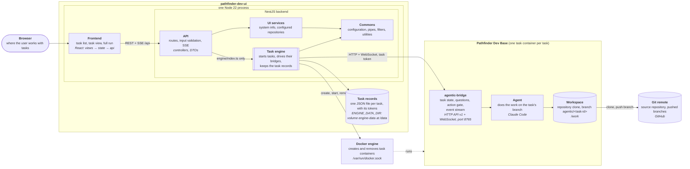
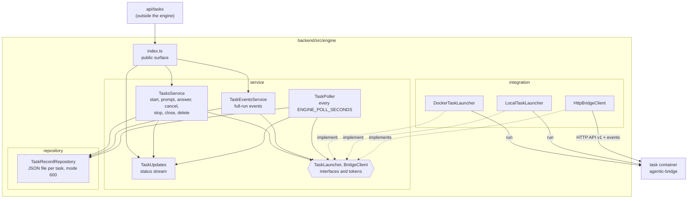

# pathfinder-dev-ui

A web UI for [agentic-dev-base](https://github.com/popescualextraian/agentic-dev-base) tasks. You pick a
repository, write a prompt, and the app starts a container with the repository's agentic image, runs the
agent in it and shows you the run: its state, its questions, its last answer and the full event stream.
You can reply, answer questions, cancel a turn, close the task when it is done, or open the branch it
pushed.

One Node process (NestJS, Node 22+) serves the React frontend and the REST/SSE API under `/api`. Behind
the API sits the **task engine** (`backend/src/engine`): the part that starts task containers, talks to
their bridges and keeps the task records. It is its own package with no dependency on the rest of the
backend except `commons`, so it can later move to a project of its own.

```sh
npm install && npm run build
cp .env.example .env   # set ENGINE_IMAGE and your tokens, see Configuration
npm start              # http://localhost:3000
```

No Docker at hand? `npm run start:local` runs tasks as local processes (see Local launcher).

## Architecture



The `ui` box is the compose service `ui` (or `npm start` on the host); a task container runs the
image `ENGINE_IMAGE`, built by `agentic build`. The task records belong to the engine, not to the
task containers: in the compose setup they are
in the `engine-data` volume of the `ui` container, with `npm start` in the host folder
`ENGINE_DATA_DIR` names. Each task container has its own volume (`agentic-ui-task-<id>` at `/task`),
removed when the task is closed. With the `local` launcher a task is a process on the host instead
of a container, and Docker is not used.

- **Frontend** (`frontend/src`): task list, task view, full run. Only `api/` calls the backend.
- **api** (`backend/src/api`): HTTP only: routes, DTO validation, SSE, error mapping. Tasks routes call
  the engine through `backend/src/engine/index.ts`.
- **service / repository** (`backend/src/service`, `backend/src/repository`): what only the UI needs,
  the system info footer and the configured repositories.
- **engine** (`backend/src/engine`): everything about tasks, below.
- **commons** (`backend/src/commons`): engine configuration from `ENGINE_*` variables, global pipes,
  interceptor and filters, small utilities. The only code the engine may import from outside itself
  (checked by `backend/test/unit/engine/engine-boundary.spec.ts`).

## Task engine



A task is one container (or, with the `local` launcher, one process) running the project's agentic
image with `agentic-bridge` as its command:

1. `TasksService.start` writes the record (prompt, two random tokens) and asks the launcher
   (`ENGINE_LAUNCHER`) to create the container, with the prompt in its environment; it gets back the
   bridge's base URL.
2. The container clones the repository, starts the bridge on branch `agentic/<task-id>` in a worktree,
   and the agent takes the first prompt.
3. `TaskPoller` reads each active task's status view and stores state, questions and the last message in
   the record. Every change goes out on `TaskUpdates` (`GET /api/tasks/stream`).
4. `TaskEventsService` relays one task's full event stream (`GET /api/tasks/:id/events`).
5. Prompt and answer wake a container that is not running (not one stopped with `/stop`, that is
   final); `close` removes container and volume and keeps the record.

Inside the engine the same layering applies: the service owns the `TaskLauncher` and `BridgeClient`
interfaces and never imports an integration class; `TasksServiceModule` wires the implementations.
Details follow.

## Task cost

The cost plugin in the task container appends `cost-record/v1` snapshots to `ledger.jsonl` in the directory
named by `AGENTIC_COST_LEDGER_DIR` (both launchers set it to the task directory, `/task` in a container). The engine reads
that file through the launcher (also from a stopped container) when a turn ends and for the next two poll rounds, and on stop and close, keeps the
latest snapshot per session, and stores the sum as `cost` in the task record and API view. Lines that are not valid
records of this task are skipped; a closed task keeps its last cost. The UI shows it in the facts panel.

## Engine overview

The engine starts and drives agentic-dev-base tasks. A task is one container running the project's
agentic image with `agentic-bridge` as its command.

- `POST /api/tasks` creates a container (and volume) per task through a `TaskLauncher` (Docker, or the `local` process launcher for development),
  with the task's prompt, two random per-task tokens (task token, agent token), and your secrets
  (`CLAUDE_CODE_OAUTH_TOKEN`, `GH_TOKEN`) in its environment.
- The container clones the repository itself when it starts (start step `05-workspace`, git
  credentials from `GH_TOKEN`, never written to a file) and works on its own branch
  `agentic/<task-id>` in a git worktree (`AGENTIC_WORKTREE=1`). The task gets the `push` and `open-pr`
  grants (`AGENTIC_ALLOWED_ACTIONS=push,open-pr`, both launchers; `deploy` needs a named target, merges
  and protected words stay blocked by the bridge's gate); the branch stays on GitHub after the task is removed.
- The engine talks to each task's bridge (HTTP API v1, `Authorization: Bearer <task token>`) at
  `http://<container-name>:8765`. The UI and the task containers share one Docker network
  (`ENGINE_DOCKER_NETWORK`); the engine sets `AGENTIC_BRIDGE_HOSTS=<container-name>` so the bridge
  accepts that Host header. Live bridge events (WebSocket) are passed on as Server-Sent Events.
- Task records are one JSON file per task (mode 600) under `ENGINE_DATA_DIR`. They hold the tokens,
  which never leave the backend: no API response or container label contains one.
- At most `ENGINE_MAX_RUNNING` task containers run at once; a start (or waking a suspended task)
  beyond that is refused with 409. Prompting or answering a task whose container is not running
  (suspended, or stopped outside the engine with `docker stop`) starts it first and waits for its
  bridge. A task stopped with `POST /stop` (or whose bridge reports `stopped`) is final: prompt and
  answer are refused with 409 ("task is stopped") at once, without starting its container.
- **Task poller.** Every `ENGINE_POLL_SECONDS` the engine reads `GET /events?since=<last seq>&view=status`
  (the bridge's status view: `state`, `question`, `answer`, `error` and final `message` events, with the full
  stream's `seq` numbers) of every task that is `starting` or `running`, and once of a task it has just acted on
  (a new task, a prompt, an answer, a wake-up). It keeps in the record the state, the open questions, the
  whole last agent message (`lastMessage`, not cut to 300 characters like the bridge's `summary`) and the
  cursor, so nothing is lost between polls or across an app restart. Idle, suspended, stopped and closed
  tasks change only through the engine's own actions and are not polled. A failed poll (container gone,
  bridge not answering) is logged and retried in the next round; it does not change the state. Up to four
  tasks are polled at once. Every change a poll or an action makes to a task is also sent on the status
  stream (`GET /api/tasks/stream`).
- **Closing.** `POST /api/tasks/:id/close` stops the task if it runs, removes its container and volume and
  keeps the record (prompt, last response, branch, times) with `closed: true`; the task then belongs to
  the `done` section. A closed task takes no prompt, answer or cancel (409). `DELETE` removes the record of a
  closed (or stopped) task for good.
- Task container: image `ENGINE_IMAGE`, name and volume `agentic-ui-task-<id>` (volume mounted at
  `/task`), labels `agentic-ui.task=<id>` and `agentic-ui.kind=task`, all capabilities dropped,
  `no-new-privileges`. Removing a task deletes container, volume and record.

The task needs its repository cloned **before the bridge starts**: with `AGENTIC_WORKTREE=1` the
bridge creates the worktree at boot and exits ("could not create the worktree") if `/work` is not a
git checkout with at least one commit. In the Docker launcher the `05-workspace` start step does the
clone from `AGENTIC_REPO_URL`.

The engine has no authentication of its own: whoever can reach port 3000 can start tasks that use
your tokens. Do not expose it beyond a trusted network.

## Configuration

The engine reads environment variables (`backend/src/commons/engine-config.ts`); copy
`.env.example` to `.env` (git-ignored) and fill it in. The app refuses to start when a required value
is missing or invalid, naming the variable, never printing a value.

| Variable | Required | Meaning |
|---|---|---|
| `ENGINE_LAUNCHER` | no, default `docker` | Which launcher runs tasks: `docker` or `local` (see Local launcher). An unknown value is refused when the launcher is created. |
| `ENGINE_LOCAL_AGENT` | no, default `fake`; `local` only | `fake` (scripted fake agent) or `claude` (the bridge's default agent, Claude Code). Anything else is refused at start-up. |
| `ENGINE_IMAGE` | `docker` only | Task image that runs `agentic-bridge`: the project's agentic image built with `agentic build`, for example `agentic-pathfinder-dev-ui:local`. Not the image of `Dockerfile`. |
| `ENGINE_DOCKER_NETWORK` | `docker` only | Docker network shared by the UI and the task containers (`agentic-ui` in `compose.yaml`). |
| `ENGINE_DATA_DIR` | yes | Absolute directory for task records (`/data` in `compose.yaml`). |
| `ENGINE_REPO_URL` | yes | Repository tasks clone when the request gives no `repoUrl`. Must not contain credentials. |
| `ENGINE_REPOS` | no | JSON array of `{"name", "url"}`: more repositories a task can be started in by name (`repository` in `POST /api/tasks`, listed by `GET /api/repositories`). Names are unique (letters, digits, `.`, `_`, `-`); URLs are https without credentials (a bad value is refused at start-up naming only the variable). `ENGINE_REPO_URL` stays the default, named after the last part of its URL. The host of every listed URL is an allowed repository host. Example: `[{"name":"docs","url":"https://github.com/acme/docs.git"}]` |
| `ENGINE_POLL_SECONDS` | no, default `15` | Seconds between two rounds of the task poller (positive integer). |
| `ENGINE_ALLOWED_REPO_HOSTS` | no | Comma-separated hosts a request's `repoUrl` may use, in addition to the host of `ENGINE_REPO_URL` (which is always allowed). The host of a repository gets `GH_TOKEN` for the clone, so other hosts are refused with 400. |
| `ENGINE_PROJECT` | yes | Project name passed to tasks (`AGENTIC_PROJECT`). |
| `ENGINE_GIT_NAME` | `docker`; `local` only when `GH_TOKEN` is set | Commit author and committer name of task containers (`GIT_AUTHOR_NAME`, `GIT_COMMITTER_NAME`). |
| `ENGINE_GIT_EMAIL` | `docker`; `local` only when `GH_TOKEN` is set | Commit author and committer email (`GIT_AUTHOR_EMAIL`, `GIT_COMMITTER_EMAIL`). |
| `ENGINE_MAX_RUNNING` | no, default `2` | Maximum running task containers (positive integer). |
| `CLAUDE_CODE_OAUTH_TOKEN` | `docker`; `local` only with `ENGINE_LOCAL_AGENT=claude`; secret | Passed into task containers. |
| `GH_TOKEN` | `docker`; optional for `local` (needed only to push); secret | Passed into task containers; used for the clone and for push. |
| `ENGINE_TASK_EXTRA_ENV` | no, test hook | JSON object of strings added to each task container's environment (keys must be valid variable names; keys the engine sets itself, such as the tokens, `GH_TOKEN`, `AGENTIC_TASK_ID`, `AGENTIC_BRANCH`, `AGENTIC_BRIDGE_HOSTS`, the four `GIT_AUTHOR_*`/`GIT_COMMITTER_*` identity variables, `GIT_CONFIG_COUNT` and `GIT_CONFIG_KEY_<n>`/`GIT_CONFIG_VALUE_<n>`, are refused at start-up). |
| `ENGINE_TASK_EXTRA_BINDS` | no, test hook | JSON array of `host:container[:mode]` binds added to each task container. |

`ENGINE_DATA_DIR`, `ENGINE_REPO_URL` and `ENGINE_PROJECT` are required for every launcher. `PORT` (default 3000) sets the HTTP port; the app listens on all interfaces. Docker itself is reached through the usual socket or
`DOCKER_HOST` (dockerode).

## REST API

All under `/api`, JSON, times are ISO 8601 UTC strings. A task view contains the task's fields without tokens:

| Field | |
|---|---|
| `id`, `title`, `prompt` | `title` is the given one or the prompt's first line, at most 80 characters; `prompt` is the whole initial prompt |
| `repository`, `repoUrl`, `repoRef?`, `model?`, `branch` | `repository` is the name (from `/api/repositories`, or the last part of the URL for another URL) |
| `state`, `reason?`, `section` | `state` is the last known one (`starting` `running` `waiting` `idle` `suspended` `stopped` `failed` `interrupted`); `section` is computed: `closed` or `stopped` → `done`; `waiting`, `failed`, `interrupted` → `needs-you`; `starting`, `running` → `working`; `idle`, `suspended` → `in-review` |
| `questions` | open questions only: `{id, source, text, options, recommendation, asked}` |
| `lastMessage?`, `lastMessageAt?`, `summary?` | the whole last agent message (from the poller) and its time; `summary` is the bridge's, cut to 300 characters, a fallback |
| `cost?` | what the task cost: `{input, output, cacheRead, cacheWrite, usd: {estimate?, billedCredits?, unknown?}, sessions, snapshotAt, readAt}`; USD per source, never summed across sources (see Task cost) |
| `createdAt`, `updatedAt`, `closed`, `closedAt?` | `updatedAt` is the last change of the record; a record without `closed` counts as not closed |

| Route | Does | Success |
|---|---|---|
| `GET /api/repositories` | `[{name, url, default}]`, the default first (see `ENGINE_REPOS`) | 200 |
| `POST /api/tasks` `{prompt, title?, repository?, repoUrl?, repoRef?, model?}` | Starts a task and waits for its bridge. `repository` is a name from `/api/repositories`; with `repoUrl` too it is 400, as is an unknown name. `repoUrl` must be https without credentials, on an allowed host (see `ENGINE_ALLOWED_REPO_HOSTS`). With neither, the default repository (`ENGINE_REPO_URL`). | 201 task |
| `GET /api/tasks` | All tasks, newest `createdAt` first, closed ones included, as last recorded (no bridge call) | 200 |
| `GET /api/tasks/:id` | Task with live bridge status (state, reason, open questions, summary, branch); a closed task is read from its record | 200 |
| `POST /api/tasks/:id/prompt` `{text}` | Sends a prompt; wakes a container that is not running first; 409 for a closed or stopped task | 202 task |
| `POST /api/tasks/:id/answer` `{text, question?}` | Answers a question; default is the oldest open one; wakes like prompt; 409 for a closed or stopped task, or without an open question | 202 task |
| `POST /api/tasks/:id/cancel` | Cancels the running turn; 409 for a closed task | 202 task |
| `POST /api/tasks/:id/close` | Stops the task if it runs, removes container and volume, keeps the record with `closed: true`. Closing a closed task is 202 as well | 202 task |
| `POST /api/tasks/:id/stop` | Bridge `/stop`, then stops the container | 202 task |
| `DELETE /api/tasks/:id` | Removes the record (and container and volume, if still there); 409 unless the task is closed or stopped | 204 |
| `GET /api/tasks/:id/events?since=N` | Events after sequence number N as a JSON array; 409 when the container is not running (always for a closed task) | 200 |
| `GET /api/tasks/:id/events/stream?since=N` | The full run: the same events, then live ones, as SSE (`id` is the event `seq`; `Last-Event-ID`, which EventSource sends on reconnect, takes precedence over `since` when present) | 200 |
| `GET /api/tasks/stream` | The status stream, SSE: `event: task` with the task view when a task is created or changed (state, questions, last message, title, closed), `event: removed` with `{"id"}` when one is deleted, and a `: ping` comment every 25 seconds. Nothing is replayed on connect: load `GET /api/tasks` first (and again after a reconnect), then apply the events. | 200 |
| `GET /api/system/info` | `{ name, version, uptimeSeconds }` | 200 |

Errors: bridge 400, 404, 409 and 503 pass through with the bridge's message; any other bridge answer
(including 401/403) and an unreachable bridge give 502 with a fixed message. An unknown task is 404;
starting beyond `ENGINE_MAX_RUNNING` is 409. Limits: `prompt`/`text` at most 20000 characters and not
blank, `title` at most 200 (shortened to 80). Errors have the body `{statusCode, message, path}` (a validation error is 400 with `message` as a list of strings). Errors inside an SSE stream that already started arrive as an SSE `error` event.

## Install

```sh
npm install
```

Needs Node 22+.

## Build and run

```sh
npm run build   # backend -> dist/, frontend (Vite) -> dist/frontend
npm start       # http://localhost:3000 (set PORT to change); needs the ENGINE_* variables, see Configuration
```

The frontend is served at `/`, the API under `/api`. For frontend development,
run `npm start` and, in a second terminal, `npm run dev:frontend` (Vite proxies `/api` to port 3000).

## Local launcher (no Docker)

`ENGINE_LAUNCHER=local` runs each task as an `agentic-bridge` child process of the app instead of a
container: own folder under `ENGINE_DATA_DIR/local-tasks/<id>`, own port (the app reaches it on the loopback address, but the real bridge listens on all interfaces, 0.0.0.0, and only its tokens protect it), a clone of
`ENGINE_REPO_URL` (a URL or a local path) on branch `agentic/<task-id>`. The bridge is the real one
(`agentic-bridge` must be on PATH) with an environment built explicitly, not inherited. The agent is
the fake agent by default (`ENGINE_LOCAL_AGENT=fake`: `tools/fake-agent/fake-agent.mjs`, no token reaches the bridge)
or Claude Code (`ENGINE_LOCAL_AGENT=claude`, which needs `CLAUDE_CODE_OAUTH_TOKEN` and costs real tokens).
There is **no isolation** between tasks or from the app: development only. The app logs a warning
at start-up. The fake agent's `SHELL:` prompt runs commands as the app's user, so anyone who can send a prompt
can read what the app's user can read (including the app's environment); keep real tokens out of such an app.
`npm run start:local` therefore drops `CLAUDE_CODE_OAUTH_TOKEN` from the app's environment when the agent is `fake`,
and `GH_TOKEN` as well when `ENGINE_REPO_URL` is a local path. `ENGINE_MAX_RUNNING` applies as usual. Stopping the app (SIGINT/SIGTERM) stops the bridges (each bridge runs in its own process group, which is killed as a whole).
Local tasks do not survive an app crash or restart: after a SIGKILL of the app, bridges may be left running and must be stopped
manually. `ENGINE_TASK_EXTRA_ENV` and `ENGINE_TASK_EXTRA_BINDS` are ignored by `local`, and SSH-form repository URLs
(`git@host:path`) are not supported (use https or a local path). The clone is aborted after 120 seconds.

```sh
PORT=3101 npm run start:local   # builds, then runs in the foreground; Ctrl-C stops it
```

`npm run start:local` (`tools/start-local.mjs`) runs `npm run build`, then `node dist/backend/main.js` with
`ENGINE_LAUNCHER=local`, `PORT` (default 3100) and `ENGINE_DATA_DIR=<checkout>/.local/<port>/`, which is wiped
and recreated at every start (`.local/` is git-ignored). Defaults that your environment overrides:
`ENGINE_REPO_URL` = the checkout itself (absolute path), `ENGINE_PROJECT` = the checkout's folder name,
`ENGINE_LOCAL_AGENT=fake`, `ENGINE_GIT_NAME`/`ENGINE_GIT_EMAIL` = a dummy identity. The script's pid is in
`.local/<port>.pid` (`kill $(cat .local/3101.pid)` stops the app and its bridges). Several checkouts or ports can run side by side.

The fake agent and `agentic-bridge` come from a checkout of this repository and the machine's PATH: the
`Dockerfile` image contains neither `tools/` nor the bridge, so use `local` from a checkout (the Docker image is for the `docker`
launcher). `tools/` is deliberately not copied into the image: `local` would still lack `agentic-bridge` there.

## Run in Docker

Two different images are involved:

- The **task image** (`ENGINE_IMAGE`) is the project's agentic-dev-base image, built with
  `agentic build` (for example tagged `agentic-pathfinder-dev-ui:local`). Task containers run it.
- The **UI image** is built from `Dockerfile` (Node 22, `npm ci`, `npm run build`, runs
  `node dist/backend/main.js` as user `node`, port 3000). It only contains this engine.

```sh
agentic build                       # the task image; note its tag for ENGINE_IMAGE
cp .env.example .env                # fill in secrets, ENGINE_IMAGE, ENGINE_REPO_URL, ENGINE_PROJECT, ENGINE_GIT_*
DOCKER_GID=$(stat -c %g /var/run/docker.sock) docker compose up --build
```

`compose.yaml` runs service `ui` (published on `127.0.0.1:${UI_PORT:-3000}` only) with `.env`, the Docker socket, a named volume `engine-data` at
`/data` (task records), `group_add` of the numeric `DOCKER_GID` (so the non-root user may use the
socket; compose refuses to start without it), and a network with the fixed name `agentic-ui`. It sets
`ENGINE_DOCKER_NETWORK=agentic-ui` and `ENGINE_DATA_DIR=/data`, which win over `.env`; `ENGINE_IMAGE`
defaults to `agentic-pathfinder-dev-ui:local`. Task containers started by the UI join `agentic-ui`, so
the UI reaches each bridge by container name. Host paths in `ENGINE_TASK_EXTRA_BINDS` refer to the
Docker host, not to the UI container.

Warning: access to the Docker socket is root on the host. Whoever controls this container, or can
call its API, can control the host. Run it only where that is acceptable.

Push credentials: the task image configures git credentials only for the clone host during its own
start steps, so the engine also gives each task container the same git settings through
`GIT_CONFIG_COUNT` and `GIT_CONFIG_KEY_0..3`/`GIT_CONFIG_VALUE_0..3` for the host of the task's
repository (the same entries as `git_cred_env` in agentic-dev-base). Git then sends
`${GH_TOKEN:-$GIT_TOKEN}` to `https://<host>` and rewrites `git@<host>:` and `ssh://git@<host>/` to https,
so the agent can push without SSH keys. The values contain only the variable reference, never
the token, and nothing is written to a file. Commits are made as `ENGINE_GIT_NAME <ENGINE_GIT_EMAIL>`.

Secrets in container environments: each task container gets `CLAUDE_CODE_OAUTH_TOKEN`, `GH_TOKEN`,
its task token and its agent token as environment variables, so anyone who can run `docker inspect`
on it (anyone with Docker socket access, i.e. root-equivalent anyway) can read them; the same holds
for `CLAUDE_CODE_OAUTH_TOKEN` and `GH_TOKEN` in the `ui` container's environment (from `.env`). This
is accepted for now; API responses and container labels never contain them.

The Docker parts (`Dockerfile`, `compose.yaml`, `npm run test:docker`) were written without a Docker
daemon available and have not been run yet; `docker compose config` accepts the compose file.

## Test

| Command | What |
|---|---|
| `npm test` | Jest unit tests: backend (`backend/test/unit/`) and frontend (`frontend/test/`, jsdom + React Testing Library) |
| `npm run test:e2e` | Backend e2e tests (`backend/test/e2e/`, Jest + supertest; REST API with a fake launcher and a fake bridge). Needs a prior `npm run build` for the frontend tests. |
| `npm run test:bridge` | `backend/test/bridge/`: the real `agentic-bridge` as a local process with a fake agent (`tools/fake-agent/fake-agent.mjs`), driven through the bridge client, the task service and the REST API (local launcher); also the poller and the status stream (a turn, an `ASK:` question and its answer, close), with a one-second poll interval. Skipped with a message on stderr where `agentic-bridge` is not on PATH. |
| `npm run test:docker` | `backend/test/docker/`: real Docker, real task image, fake agent: start a task, reach idle, prompt and see the echo, wake it after `docker stop`, stop it (a prompt is then refused with 409 without starting it), remove, check container and volume are gone. Needs both `ENGINE_IMAGE` (the task image) and `FAKE_AGENT_DIR` (directory holding agentic-dev-base's `bridge/test/fake-agent.mjs`, mounted at `/fake`), and a reachable Docker daemon (Linux Docker or Docker Desktop); otherwise skipped with a message on stderr. The test process never connects to container IPs: bridge requests run in a helper container from `ENGINE_IMAGE` on the test network (`node` with a small built-ins-only script, `backend/test/docker/bridge-request.cjs`) and reach the task by container name, as the UI does. It creates a temporary network, the helper container and a local git repository (bound into the task and cloned from there, no GitHub needed), and removes all of them, task containers and volumes in `afterAll`, also after a failure. Example: `ENGINE_IMAGE=agentic-pathfinder-dev-ui:local FAKE_AGENT_DIR=/path/to/agentic-dev-base/bridge/test npm run test:docker` |
| `npm run test:ui` | Playwright (`e2e/`). Builds and starts the app on port 3100, uses the Chromium under `PLAYWRIGHT_BROWSERS_PATH` if set. |
| `npm run lint` | ESLint for `backend/src/` and `backend/test/` |

## Launchers

A launcher runs task containers somewhere. The interface is `TaskLauncher` in
`backend/src/engine/service/task-launcher.ts`:

```ts
launch(spec: LaunchSpec): Promise<LaunchResult>   // create and start; returns the bridge base URL
start(taskId: string): Promise<void>              // start an existing, stopped container
stop(taskId: string): Promise<void>
remove(taskId: string): Promise<void>             // container and volume; no-op when gone
inspect(taskId: string): Promise<TaskInspection>  // { exists, running, bridgeUrl }
countRunning(): Promise<number>                   // for the ENGINE_MAX_RUNNING cap
```

The bridge client does not depend on the launcher: the launcher only returns the bridge base URL, and
the service talks to that URL with the task token. To add another launcher (for example Azure):

1. Implement `TaskLauncher` in `backend/src/engine/integration/launcher/` (it gets the `EngineConfig`).
2. Register it in `backend/src/engine/integration/launcher/task-launcher.factory.ts` under a new name.
3. Use that name as `ENGINE_LAUNCHER`.
4. Add unit tests next to `docker-task-launcher.spec.ts`; the bridge URL it returns must be reachable
   from the engine, and the container needs the same environment contract as the Docker one
   (`AGENTIC_TASK_TOKEN`, `AGENTIC_AGENT_TOKEN`, `AGENTIC_BRIDGE_HOSTS`, ... see `DockerTaskLauncher`).

## Layout

```
backend/
  src/
    main.ts, app.setup.ts   bootstrap; global prefix /api, pipe, interceptor, filters
    app.module.ts           imports the api modules and serves dist/frontend
    api/<area>/             controllers (HTTP only, no business logic): system/, repositories/, tasks/ (+ dto/)
    service/<area>/         UI business logic: system/, repositories/
    repository/<area>/      UI storage: system/ (package.json)
    engine/                 the task engine package; others import only engine/index.ts
      service/              tasks.service.ts, task-poller.ts, task-updates.ts, task-view.ts, task-events.service.ts,
                            the TaskLauncher and BridgeClient interfaces
      integration/          bridge/ (HttpBridgeClient), launcher/ (Docker and local launchers, factory)
      repository/           task-record.repository.ts (JSON files)
    commons/                engine config, validation pipe, logging interceptor, exception filters, shared utilities
  test/
    unit/                   unit tests, mirroring src/
    e2e/                    Nest + supertest tests and their Jest config
    bridge/                 real-bridge suite (npm run test:bridge)
    docker/                 real-Docker suite (npm run test:docker)
    helpers/                fake bridge, fake and local-process launchers
tools/fake-agent/           fake agent (fake-agent.mjs): bridge suite and the local launcher
tools/start-local.mjs       npm run start:local
frontend/
  src/
    api/                    the only code that calls the backend
    state/                  hooks holding the data
    views/                  components; they use state, never api/
  test/                     unit tests, mirroring src/
e2e/                        Playwright tests (whole app)
package.json                one, at the root
Dockerfile, compose.yaml    the UI image and its compose setup (see Run in Docker)
.env.example                engine configuration template
```

Build output: `dist/backend` (Nest) and `dist/frontend` (Vite).

## Layer rules

- Backend dependencies go only downwards: `api` → `service` → `integration` / `repository` → `commons`. Integration = external systems and
  runtimes (launchers, bridge client); repository = storage only. The service owns the interfaces it needs
  (`TaskLauncher`, `BridgeClient` and their tokens) and imports no integration class; only its Nest module
  imports the integration module.
- The task engine (`engine/`) keeps the same layers inside itself, imports nothing from the backend
  but `commons/`, and is used from outside only through `engine/index.ts`
  (`backend/test/unit/engine/engine-boundary.spec.ts` checks both).
- Each area has one Nest module per layer (`<Area>ApiModule`, `<Area>ServiceModule`,
  `<Area>IntegrationModule`, `<Area>RepositoryModule`); a layer's module imports only the module of the layer below.
- Routes are prefixed with the area: `/api/<area>/...`.
- Cross-cutting concerns (validation, logging, errors) live in pipes, interceptors and filters
  in `commons/`, registered globally in `app.setup.ts`, not in each method.
- Frontend: `views` → `state` → `api`.
