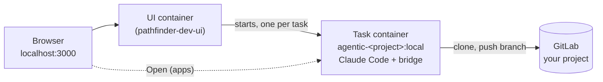

# Team setup: Pathfinder on your machine

From nothing to the Pathfinder UI at http://localhost:3000, working on your project, with every task in its own
container. Takes about 45 minutes, most of it image builds. Done once per machine; a second project takes 10 minutes.

## Let Claude do it

Open Claude Code on Windows (any folder; the desktop app or `claude` in a terminal) and say:

> Set up Pathfinder for me: download
> https://raw.githubusercontent.com/popescualextraian/pathfinder-dev-ui/main/.claude/skills/pathfinder-setup/SKILL.md
> and follow it. My project is https://gitlab.example.com/group/my-project.git

Claude drives Ubuntu from Windows (`wsl.exe`), checks each step, does what is missing and asks before anything runs
as root. It never asks for a token in the chat: it opens the settings file in Notepad and tells you what to paste.
You do these yourself, when it asks:

- install WSL the first time (`wsl --install -d Ubuntu`, as administrator, maybe a reboot) and create your Ubuntu
  user on its first start;
- log in for the Claude token (`claude setup-token`);
- create the GitLab token(s) on the GitLab website ([Tokens](#tokens)).

Already working inside Ubuntu with Claude Code there: `cd ~/pathfinder/pathfinder-dev-ui && claude`, then
`/pathfinder-setup` (after cloning the repository as in [step 2](#2-get-the-code)).

The rest of this page is the same setup by hand, and the reference the skill follows.



Everything runs inside WSL (Ubuntu), not on the Windows file system: containers read the Linux file system many
times faster, and scripts keep their line endings and executable bits.

## What you need

| | Why | Check |
|---|---|---|
| Windows 11 with WSL 2 and Ubuntu (22.04 or newer) | everything runs there | `wsl -l -v` in PowerShell shows Ubuntu, VERSION 2 |
| Docker Engine **inside** Ubuntu (not Docker Desktop) | builds the images, runs the UI and the tasks | `docker run --rm hello-world` in Ubuntu, without sudo |
| git, jq, curl | the `agentic` command | `git --version && jq --version && curl --version` |
| A Claude subscription (Pro, Max, Team or Enterprise) | the agent in every task, and Claude Code for the setup skill | you can log in at claude.ai |
| A GitLab personal access token for your project | tasks clone your repository and push their branches | see [Tokens](#tokens) |

Node.js is not needed: the UI is built and run in Docker.

## 1. Prerequisites

In **PowerShell** (once, if Ubuntu is not installed yet):

```powershell
wsl --install -d Ubuntu
```

Everything below runs in the **Ubuntu** terminal.

Basic tools:

```bash
sudo apt-get update && sudo apt-get install -y git jq curl ca-certificates
```

Docker Engine in Ubuntu ([docs.docker.com/engine/install/ubuntu](https://docs.docker.com/engine/install/ubuntu/)):

```bash
sudo install -m 0755 -d /etc/apt/keyrings
sudo curl -fsSL https://download.docker.com/linux/ubuntu/gpg -o /etc/apt/keyrings/docker.asc
echo "deb [arch=$(dpkg --print-architecture) signed-by=/etc/apt/keyrings/docker.asc] https://download.docker.com/linux/ubuntu $(. /etc/os-release && echo "$VERSION_CODENAME") stable" \
  | sudo tee /etc/apt/sources.list.d/docker.list
sudo apt-get update && sudo apt-get install -y docker-ce docker-ce-cli containerd.io docker-buildx-plugin docker-compose-plugin
sudo usermod -aG docker "$USER"
```

Close the Ubuntu terminal and open it again (the group change), then `docker run --rm hello-world`.
If you also have Docker Desktop: turn off its WSL integration for Ubuntu (Settings, Resources, WSL integration), so
`docker` in Ubuntu talks to the engine in Ubuntu.

Claude Code (for the setup skill and for `claude setup-token`):

```bash
curl -fsSL https://claude.ai/install.sh | bash
```

Git identity and GitLab credentials in Ubuntu, so you can clone your project:

```bash
git config --global user.name  "Your Name"
git config --global user.email "you@example.com"
git config --global credential.helper store      # asks once, then keeps the token in ~/.git-credentials (mode 600)
```

## 2. Get the code

```bash
mkdir -p ~/pathfinder && cd ~/pathfinder
git clone https://github.com/popescualextraian/pathfinder-dev-base.git
git clone https://github.com/popescualextraian/pathfinder-dev-ui.git
mkdir -p ~/.local/bin && ln -sf ~/pathfinder/pathfinder-dev-base/bin/agentic ~/.local/bin/agentic
```

Open a new terminal (Ubuntu puts `~/.local/bin` on the PATH once it exists), then `agentic help`.
From Windows the folder is `\\wsl$\Ubuntu\home\<you>\pathfinder` (Explorer, or VS Code with the WSL extension).

## 3. Build the base image

```bash
agentic build-base        # agentic-dev-base:local, about 15 minutes the first time
```

Behind a TLS-intercepting proxy: put the company CA certificate (PEM, `*.crt`) into `~/.agentic/ca/` first
(pathfinder-dev-base README, Prerequisites).

## 4. Your project

Clone it into WSL (example: vans-factory-rotation) and build its task image:

```bash
mkdir -p ~/pathfinder/projects && cd ~/pathfinder/projects
git clone https://gitlab.example.com/group/vans-factory-rotation.git   # asks for user name and the token (Tokens)
cd vans-factory-rotation
```

- **The project already has `.agentic/`** (someone set it up): go on with `agentic build`.
- **It has none:** `agentic init` writes `.agentic/` with the detected tools and the recommended setup lines;
  `agentic setup` (optional) lets an agent review the repository and propose more. Commit `.agentic/` (not
  `.agentic/.env`) so the team shares it.

```bash
agentic build             # agentic-<project>:local, for example agentic-vans-factory-rotation:local
```

**Open in web (apps).** To start the project's app from a task and open it in the browser, declare it in
`.agentic/agentic.yaml`, then `agentic build` again:

```yaml
apps:
  web:
    run: npm start          # the command, run in the task's checkout
    ports: [4200]           # ports it listens on (on 0.0.0.0)
    prepare: npm ci         # optional, once before the first start
```

Other keys (`url`, `dir`, `env`, `env_files`, `teardown`, `autostart`, `idle_stop`): pathfinder-dev-base
`docs/tasks.md`, Apps.

Two places must agree, so after changing `apps:` do both:

- **Commit and push** `.agentic/agentic.yaml`: a task clones the repository and takes the app's commands from
  the `.agentic/` it finds there (a task started on another branch, `repoRef`, uses that branch's).
- **`agentic build`** again: the image tells the UI which ports to publish, and ports cannot be added to a running
  container, so only tasks started after the build get them.

## 5. Configure the UI

The UI reads one settings file. Keep it outside the repositories (it holds tokens):

```bash
cd ~/pathfinder
cat > pathfinder.env <<'EOF'
# Pathfinder UI settings. Holds secrets: keep it mode 600, never commit it.
ENGINE_IMAGE=agentic-vans-factory-rotation:local
ENGINE_REPO_URL=https://gitlab.example.com/group/vans-factory-rotation.git
ENGINE_PROJECT=vans-factory-rotation
ENGINE_GIT_NAME=Your Name
ENGINE_GIT_EMAIL=you@example.com
UI_PORT=3000
ENGINE_MAX_RUNNING=2
# Claude subscription token: claude setup-token
CLAUDE_CODE_OAUTH_TOKEN=
# GitLab personal access token: tasks clone and push the project with it
GH_TOKEN=
EOF
echo "DOCKER_GID=$(stat -c %g /var/run/docker.sock)" >> pathfinder.env
chmod 600 pathfinder.env
```

Then fill in the two tokens with an editor (`nano ~/pathfinder/pathfinder.env`):

- `CLAUDE_CODE_OAUTH_TOKEN`: run `claude setup-token`, log in with your subscription, paste the printed token.
- `GH_TOKEN`: your GitLab token (the name is historical: it is the token for the repository's host, GitHub or GitLab).

| Setting | Meaning |
|---|---|
| `ENGINE_IMAGE` | the task image from step 4 |
| `ENGINE_REPO_URL` | https URL of the project, without credentials |
| `ENGINE_PROJECT` | the project name (`project:` in `.agentic/agentic.yaml`) |
| `ENGINE_GIT_NAME`, `ENGINE_GIT_EMAIL` | the author of the tasks' commits |
| `UI_PORT` | where the UI listens, on 127.0.0.1 |
| `ENGINE_MAX_RUNNING` | how many tasks run at once |
| `DOCKER_GID` | group of the Docker socket, written by the `stat` line above |

More repositories in one UI: `ENGINE_REPOS` (pathfinder-dev-ui README, Configuration).

## 6. Start the UI in Docker

```bash
cd ~/pathfinder/pathfinder-dev-ui
tools/deploy.sh ~/pathfinder/pathfinder.env
```

It needs the checkout on `main` with no local changes, and both tokens in the settings file (without them the UI
container keeps restarting with `... is required`). It builds the UI image, starts the UI and its Docker socket
filter, waits until both are healthy and prints the URL: open **http://localhost:3000** in your Windows browser. Start a task: write a prompt, pick the repository,
**Start**. The task clones the project, works on branch `agentic/<task id>` and pushes it when you allow it.
With apps declared, the task view lists them with **Start**, **Open**, **Logs** and **Stop**.

| | Command (in `~/pathfinder/pathfinder-dev-ui`) |
|---|---|
| Update | `git pull`, then `tools/deploy.sh ~/pathfinder/pathfinder.env` (tasks and their records survive) |
| Stop the UI | `docker compose stop` |
| Start it again | `docker compose start` (it also restarts with Docker) |
| UI logs | `docker compose logs -f ui` |
| After changing `.agentic/` of the project | `agentic build` in the project; new tasks use the new image |
| After changing `pathfinder.env` | `tools/deploy.sh ~/pathfinder/pathfinder.env` |

## 7. Optional: the GitLab backlog board and workflows

A board of the project's GitLab issues in lanes (Todo, Plan, In progress, Test, Review, Done) at `#/backlog`, and
workflows that carry a card through steps (plan, implement, review), each step a prompt in a task. Both are off until
configured; workflows need the board.

**The board's token.** The board reads and edits issues, labels, comments and members through GitLab's API, so it
needs its own token: the repository token (`GH_TOKEN`) has code rights only and gets 403.

1. GitLab: open the project, **Settings**, **Access tokens**, **Add new token** (a *project* access token: it works
   on this project only; you need the Maintainer or Owner role to create one).
2. Name `pathfinder-board`, an expiry date, role **Developer**, scope **`api`** only. Create, copy the value (GitLab
   shows it once).
3. No project access tokens on your GitLab? A classic personal access token with **`api`** works too, but reaches
   every project your account can; not a fine-grained token, and not `read_api` (it cannot move cards).

**Settings.** The lanes file, a writable folder for the workflow definitions (the editor saves there; the UI runs as
uid 1000, which is your WSL user on a default install, `id -u`), and the token:

```bash
cd ~/pathfinder
cp pathfinder-dev-ui/backlog.example.yaml backlog.yaml      # set gitlab.baseUrl and gitlab.project; lanes as you like
cp -r pathfinder-dev-ui/workflows.example workflows         # the example workflows
cat >> pathfinder.env <<EOF2
BACKLOG_CONFIG_FILE=$HOME/pathfinder/backlog.yaml
WORKFLOWS_DIR_HOST=$HOME/pathfinder/workflows
GITLAB_TOKEN=
EOF2
nano pathfinder.env                                         # paste the token after GITLAB_TOKEN=
```

Check the token without printing it (expect `"scopes":["api"]`, then `200`):

```bash
T="$(sed -n 's/^GITLAB_TOKEN=//p' ~/pathfinder/pathfinder.env)"
curl -s -H "PRIVATE-TOKEN: $T" https://gitlab.example.com/api/v4/personal_access_tokens/self | jq -c '{name,scopes,expires_at}'
curl -s -o /dev/null -w '%{http_code}\n' -H "PRIVATE-TOKEN: $T" "https://gitlab.example.com/api/v4/projects/group%2Fproject/issues"
unset T
```

Then `tools/deploy.sh ~/pathfinder/pathfinder.env`. The sidebar gets Backlog and Workflows. The first sync creates
the lanes' `status::...` labels in the project; issues without one land in the default lane. Moving a card swaps its
label in GitLab. A workflow started from a card runs real tasks (they cost like any task) and waits for your
**Continue** at each `human` gate. Lanes, workflow format and the editor: pathfinder-dev-ui README, Backlog and
Workflows.

## Tokens

| Token | Where it comes from | Rights | Goes into |
|---|---|---|---|
| Claude | `claude setup-token` (your subscription) | | `CLAUDE_CODE_OAUTH_TOKEN` |
| GitLab, for the repository | GitLab, Preferences, Access tokens, Add new token | `read_repository`, `write_repository` (fine-grained: Code: Download and Push, on the project) | `GH_TOKEN`, and your git credentials in step 1 |
| GitLab, for the board (optional) | the project, Settings, Access tokens (a project access token: works on this project only) | role Developer, scope `api` (`read_api` cannot move cards; code rights or a fine-grained token get 403) | `GITLAB_TOKEN` |

Give tokens an expiry date and only the projects they need. Every task container gets `CLAUDE_CODE_OAUTH_TOKEN`
and `GH_TOKEN` in its environment; the UI has no login, so it listens on 127.0.0.1 only: do not expose it.

## Troubleshooting

| Symptom | Fix |
|---|---|
| `permission denied ... docker.sock` | `sudo usermod -aG docker $USER`, then a new terminal |
| `agentic: command not found` | a new terminal, or `export PATH=$HOME/.local/bin:$PATH` |
| deploy: `the task image ... does not exist locally` | `agentic build` in the project (step 4); `ENGINE_IMAGE` must match its name |
| deploy: `set DOCKER_GID` | the `stat` line of step 5 |
| a task fails with `could not clone` | `GH_TOKEN` missing, expired or without read access; `ENGINE_REPO_URL` without credentials |
| a task cannot push | the token lacks write access, or the task was not allowed to push |
| the UI does not open | `docker compose ps` (both services healthy?), `docker compose logs ui` |
| the UI keeps restarting, log says `Invalid engine configuration: X is required` | set X in `pathfinder.env`, deploy again |
| a task shows no apps | `apps:` is not in the `.agentic/agentic.yaml` the task cloned (committed and pushed?), or the image was built before it (`agentic build`, then a new task) |
| an app has no link | the task was started before the image had the app's port: start a new task |
| Open shows nothing | the app must listen on `0.0.0.0`, on a port listed in `ports`; **Logs** shows its output |
| the board is empty or shows an error; `curl` above gives 401 or 403 | the board token is wrong, expired, or lacks `api` / access to the project (step 7) |
| Explorer cannot open `\\wsl$\Ubuntu\...` | use **Linux** in Explorer's left pane, or `\\wsl.localhost\Ubuntu\...`, or edit in the Ubuntu terminal with `nano` |
| a token was lost (GitLab shows it only once) | GitLab, Access tokens: **Rotate** it (new value, same rights) or create a new one; the feed token cannot be used |
